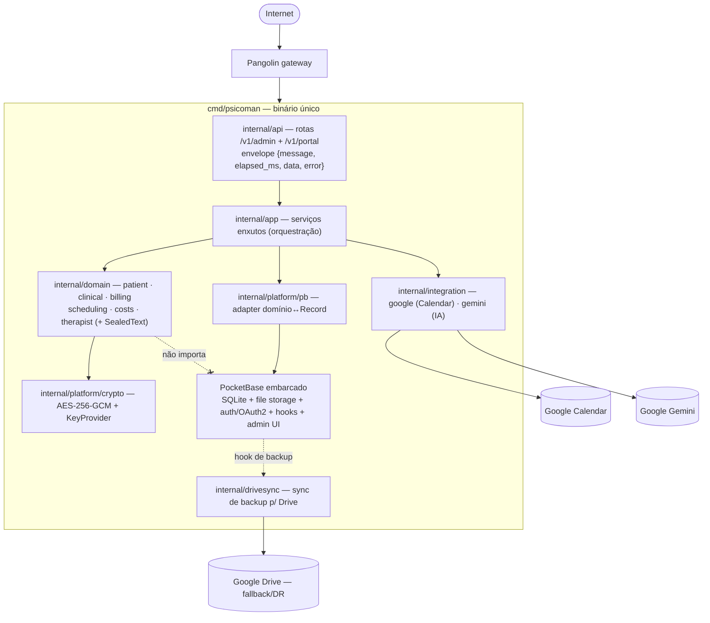

# pocketbase-core — Design

Como realizar os requisitos de [`requirements.md`](./requirements.md), respeitando os padrões da casa e a decisão de arquitetura lastreada em [`docs/decisions.md` (2026-10-21)](../../../docs/decisions.md). A arquitetura canônica em [`docs/architecture.md`](../../../docs/architecture.md) será **reescrita** para este rumo na fase de fechamento das tasks desta onda; até lá, este design é a referência.

Princípios desta onda:
- **Binário único** (`cmd/psicoman`) com o PocketBase embarcado como framework; nada de dois processos.
- **Domínio é a autoridade**: os agregados de domínio não conhecem o PocketBase; o framework fica atrás do adapter `platform/pb`.
- **Cifra no domínio**: o `SealedText` é um tipo de domínio; o PocketBase não é a fronteira de cifra.
- **Contrato próprio `/v1`**: envelope `{ message, elapsed_ms, data, error }`; a REST automática do PocketBase não é o contrato público.
- **Derivar, não reinventar**: aproveitar do PocketBase SQLite relacional, HTTP, file storage, logging, auth/OAuth2, migrations e admin UI.

Arquivos-âncora (estrutura de pastas alvo):
- `cmd/psicoman/main.go` — único; `pocketbase.New()` + `app.OnServe()`.
- `internal/domain/{patient,clinical,billing,scheduling,costs,therapist}` — bounded contexts + o tipo de valor `SealedText`.
- `internal/app` — serviços de negócio enxutos (orquestração).
- `internal/platform/crypto` — AES-256-GCM, envelope do `SealedText`, `KeyProvider`.
- `internal/platform/pb` — adapter domínio↔`Record` do PocketBase (único que conhece o PB).
- `internal/integration/{google,gemini}` — Calendar/Gmail/Drive e IA.
- `internal/drivesync` — sync de backup para o Drive (fallback/DR).
- `internal/api` — rotas `/v1/*` próprias, envelope PT-BR, sobre o router do PB.

---

## D0. Visão geral (R1, R2, R5)

O binário único fica atrás do `Pangolin`. O PocketBase embarcado provê SQLite, file storage e hooks; as rotas `/v1/*` próprias são registradas sobre o router dele. O fluxo de dependência aponta sempre para o domínio: `api → app → domain`; `platform/pb` é o único a conhecer o PocketBase; o domínio não importa o framework.



**Escolha:** o fluxo de dependência é unidirecional em direção ao domínio; o PocketBase é um detalhe de infraestrutura confinado a `platform/pb` e ao `pbcore` embarcado. Realiza R1, R2, R5.

---

## D1. PocketBase como framework / binário único (R1)

- `cmd/psicoman/main.go` instancia `app := pocketbase.New()` e registra as rotas próprias no hook `app.OnServe()`, que entrega o `*http.ServeMux`/router sobre o qual montamos os grupos `/v1/admin/*` e `/v1/portal/*` ([doc oficial de routing](https://pocketbase.io/docs/router) — conteúdo rephrased para conformidade de licença).
- Aproveitamos do PocketBase: SQLite relacional com constraints/relations, servidor HTTP, file storage/server, logging, auth/OAuth2, migrations e admin UI. Isso recupera os invariantes transacionais (R1.3) que as alternativas descartadas não davam.
- **Escolha:** a REST automática do PocketBase **não** é o contrato público. Ela pode ficar restrita (via regras de coleção) ou ignorada; o contrato é `/v1/*` (ver D7). Isso evita acoplar clientes ao formato interno das coleções e preserva o envelope próprio.

Realiza R1.1, R1.2, R1.3.

---

## D2. Segregação lógica admin/portal (R2)

- Dois grupos de rota sobre o mesmo router: `/v1/admin/*` e `/v1/portal/*`. Cada grupo tem sua cadeia de middleware e suas regras de auth (ver D3). Nada de dois binários.
- O `Pangolin` publica para a internet só o necessário do portal; o admin assume o gateway como borda.
- **Escolha:** segregação por namespace de rota + middleware, não por processo. Simplifica o roll out (um binário) sem perder a separação de superfícies. Realiza R2.1, R2.2.

---

## D3. Auth atrás do `Pangolin` + gate de aprovação (R3)

- **Admin:** a identidade chega por um **header injetado pelo `Pangolin`** (ex.: usuário autenticado no gateway). Um middleware no grupo `/v1/admin/*` lê o header e recusa (401) se ausente — defense-in-depth mesmo confiando no gateway.
- **Portal:** cadastro/login do paciente usam a coleção de auth do PocketBase, expostos só em `/v1/portal/*`.
- **Gate de aprovação:** o paciente nasce `pendente`; o terapeuta move para `aprovado`/`rejeitado`. O enforcement é um **hook do PocketBase** no servidor: requisições do portal de um paciente não-`aprovado` a recursos além do próprio cadastro são negadas (403), independentemente da UI.
- **Escolha:** manter o gate como hook de servidor (e não só regra de coleção) centraliza a decisão de negócio e a torna testável por E2E (caminho permitido 2xx e negado 403). Realiza R3.1, R3.2, R3.3.

---

## D4. Domínio rico por bounded context (R4)

- Cada bounded context é um pacote sob `internal/domain`, com agregados que carregam comportamento, serialização e ações. Os serviços em `internal/app` orquestram (abrem transação via porta, chamam o agregado, persistem via `platform/pb`).
- Mapeamento das entidades atuais (de `docs/architecture.md §3`) para os contexts:

| Bounded context | Entidades/agregados |
|-----------------|---------------------|
| `patient`       | paciente, origem/indicação, estado de aprovação |
| `clinical`      | sessão (nota de sessão), nota livre, anamnese, resumo de IA, tags clínicas — campos sensíveis como `SealedText` |
| `billing`       | plano, débito, pagamento, contrato |
| `scheduling`    | pedido de agendamento, ciclo de vida da sessão (status/confirmação/cancelamento) |
| `costs`         | categoria de custo, item de custo, custo de sessão, ROI |
| `therapist`     | perfil do terapeuta, links, locais de atendimento |

- **Escolha:** OO bem feita — comportamento no agregado, serviço enxuto. Um agregado sabe validar-se, transitar de estado e formatar seu log (sem vazar conteúdo clínico). Realiza R4.1, R4.2, R4.3.

---

## D5. Ports & Adapters — `platform/pb` (R5)

- O domínio/app define **interfaces de porta** (repositórios), por exemplo:

```go
// Porta de persistência de paciente, definida no domínio/app.
// O domínio NÃO conhece o PocketBase.
type PatientRepository interface {
    Create(ctx context.Context, p *patient.Patient) error
    GetByID(ctx context.Context, id string) (*patient.Patient, error)
    GetByEmail(ctx context.Context, email string) (*patient.Patient, error)
}
```

- O adapter concreto vive em `internal/platform/pb` e é o **único** que importa o PocketBase; ele traduz entre o agregado de domínio e o `core.Record` do PocketBase (leitura/escrita de campos, incluindo o envelope do `SealedText` como string).
- **Escolha:** manter a autoridade no domínio e o PocketBase atrás da porta. Trocar o PocketBase por outra base = reescrever só `platform/pb` e as migrations, sem tocar domínio/serviços. Realiza R5.1, R5.2.

---

## D6. Cripto por campo — `SealedText` (R6)

Assinatura conceitual (não é implementação; só o contrato do tipo):

```go
// SealedText guarda texto clínico cifrado em repouso.
// Em claro só via Reveal(ctx); MarshalJSON emite sempre o envelope cifrado.
type SealedText struct {
    // envelope já formatado (versao.algoritmo.id_chave.nonce.ciphertext, base64)
    // + referência ao KeyProvider para Reveal sob demanda.
}

// MarshalJSON emite o envelope cifrado — nunca o claro.
// -> "versao_do_esquema.algoritmo.id_da_chave.nonce.ciphertext" (base64)
func (s SealedText) MarshalJSON() ([]byte, error)

// UnmarshalJSON faz o parse do envelope e mantém o conteúdo cifrado.
func (s *SealedText) UnmarshalJSON(b []byte) error

// Reveal decifra sob demanda (resolve a chave pelo id_da_chave via KeyProvider).
func (s SealedText) Reveal(ctx context.Context) (string, error)

// Seal cifra um texto em claro produzindo o envelope com a chave corrente.
func Seal(ctx context.Context, plaintext string) (SealedText, error)

// KeyProvider resolve a chave por id (rotação) e informa o id corrente.
type KeyProvider interface {
    Key(id string) ([]byte, error)
    CurrentID() string
}
```

- **Envelope:** `versao_do_esquema.algoritmo.id_da_chave.nonce.ciphertext` (campos em base64, separados por ponto). O `id_da_chave` habilita rotação; `versao_do_esquema`/`algoritmo` habilitam evoluir o algoritmo sem quebrar dados antigos. Algoritmo **AES-256-GCM**, no pacote `internal/platform/crypto`.
- **Escolha:** implementar a cifra com `crypto/aes` + `crypto/cipher` no `internal/platform/crypto`, para controlar o **envelope** e a **rotação** por `id_da_chave`. O PocketBase expõe `security.Encrypt(data, key)` / `security.Decrypt(cipherText, key)` (AES-256-GCM, chave de 32 chars) como referência de que o framework usa o **mesmo primitivo**, mas o PocketBase **não** cifra arquivo/DB sozinho — a cifra é do **nosso** `SealedText`, com nosso envelope versionado ([`tools/security/encrypt.go`](https://github.com/pocketbase/pocketbase/blob/master/tools/security/encrypt.go) e [discussão #4530](https://github.com/pocketbase/pocketbase/discussions/4530) — rephrased para conformidade de licença).
- **Cifra por campo:** só os campos clínicos sensíveis (corpo da sessão, anamnese, notas, resumo de IA) são `SealedText`. Nome, email, telefone, datas, status e valores ficam em claro e indexáveis. A busca clínica se dá pelas **tags** (claro) — ver D10 —, nunca pelo corpo cifrado.

Realiza R6.1, R6.2, R6.3, R6.4, R6.5.

---

## D7. Contrato de API `/v1` (R2, R7)

- Rotas versionadas sob `/v1/*`, namespaces `/v1/admin/*` e `/v1/portal/*`, registradas no `app.OnServe()`.
- Envelope de resposta `{ message, elapsed_ms, data, error }` (`message` em PT-BR). Exemplo de sucesso:

```json
{
  "message": "Sessão criada com sucesso.",
  "elapsed_ms": 12,
  "data": {
    "id": "01JBX8Z0K3M9R2V7Q4T6N5W8AE",
    "patient_id": "01JBX7Y...",
    "starts_at": "2026-10-21T14:00:00-03:00",
    "modalidade": "online",
    "status": "agendada"
  },
  "error": null
}
```

Exemplo de erro:

```json
{
  "message": "Não foi possível agendar: horário em conflito.",
  "elapsed_ms": 8,
  "data": null,
  "error": { "code": "conflito_de_horario" }
}
```

- **Middleware chain** (equivalente ao que o projeto já usa): recover → request-id → timing (preenche `elapsed_ms`) → logging → auth do namespace (header do `Pangolin` no admin; sessão de paciente no portal) → handler.
- **Exemplos de rota:**
  - `POST /v1/admin/sessions` — cria/agenda uma sessão (checa conflito via Calendar, D8).
  - `GET /v1/admin/patients/{id}/debts` — lista débitos do paciente.
- **Swagger:** o contrato `/v1/*` é descrito em OpenAPI, mantido no mesmo ciclo da mudança de contrato.
- **Escolha:** contrato próprio `/v1` com envelope, sobre o router do PocketBase; a REST automática do PB não é exposta como contrato. Realiza R2.1, R7.1, R7.2, R7.3.

---

## D8. Integração Google Calendar (síncrona) (R8)

- `internal/integration/google` expõe o Calendar via interface + fake (para teste), seguindo o padrão do projeto.
- QUANDO o terapeuta agenda/confirma: checa conflito via `freebusy`, cria o evento e, se online, gera o link do Meet — tudo **síncrono**, no caminho de request. É o único Google no caminho de request.
- QUANDO não há credenciais ou o Google está indisponível: degrada sem panic (no-op de evento + aviso no boot/log), coerente com o `dev_mode`.
- **Escolha:** manter o Calendar síncrono atrás de interface + fake preserva testabilidade e o comportamento degradado já estabelecido. Realiza R8.1.

---

## D9. Google Drive como fallback/DR (`drivesync`) (R9)

- O Drive sai do caminho de request. Um **hook no ciclo de backup** do PocketBase dispara o sync do snapshot para uma pasta fria no Drive (`internal/drivesync`), podendo rodar como segundo processo/hook.
- Escopo OAuth mínimo (`drive.file`); o snapshot é cifrado antes do upload. O Drive nunca é fonte da verdade nem caminho de request.
- **Escolha:** acoplar o sync ao evento de backup do PocketBase (em vez de um cron próprio) garante que o espelho de DR acompanha os snapshots reais, sem lógica de sync bidirecional. Realiza R9.1, R9.2.

---

## D10. IA Gemini + índice de tags (R10)

- `internal/integration/gemini` (interface + fake) faz resumo clínico + tagueamento. Disparo **explícito** pelo terapeuta; resultado **revisável** antes de consolidar.
- **Índice invertido de tags por paciente/ano** (`tag -> lista de IDs de sessão`), isolado por paciente — inspirado no modelo de `/tmp/evolucao-ref.md §3.2/§7.4`, porém com uma diferença essencial ao novo rumo: as **tags ficam em claro** (indexáveis) enquanto o corpo clínico é `SealedText` (cifrado). O Drive **não** é fonte da verdade; o índice vive em coleção do PocketBase.
- **Opt-in por instância**, default **off**. Auditoria `ai.process` **sem conteúdo clínico** nos metadados; minimização dos dados enviados. Base legal: os dados são da própria terapeuta (controladora), que já faz esse trabalho manualmente — a IA assiste.
- **Escolha:** tags em claro + corpo cifrado é o que torna a busca clínica viável sem expor conteúdo; o índice invertido por paciente/ano evita varredura cara. Realiza R10.1, R10.2, R10.3, R10.4.

---

## D11. Configuração (R1, R6, R8, R9, R10)

- **Cifra:** chave via config atrás do `KeyProvider` (`id_da_chave` corrente + chaves anteriores para rotação). Nenhuma chave em claro no repositório.
- **PocketBase:** `data dir` do PB, credenciais OAuth do Google (Calendar/Drive), parâmetros do admin UI.
- **Gemini:** flag `on/off` (default off) + chave da API, por instância.
- **Escolha:** configuração única do binário (arquivo de config + variáveis de ambiente), coerente com o roll out de um artefato só. Realiza R1.2, R6.4, R8.1, R9.2, R10.3.

---

## D12. Trade-offs

| Decisão | Escolha | Motivo |
|---------|---------|--------|
| Framework de base | PocketBase como framework (lib Go) | Recupera SQLite relacional + HTTP + file storage + auth + migrations + admin num binário só, sem reescrever infraestrutura à mão (R1). |
| Topologia de processo | Binário único | Roll out simples (um artefato); tudo roda atrás do `Pangolin`, então segregar em processos não traz ganho (R1, R2). |
| Cifra | Por campo (`SealedText`) | Mantém nome/datas/valores/tags indexáveis e cifra só o clínico sensível; preserva busca por tags (R6). |
| Acoplamento ao PocketBase | Adapter `platform/pb` (Ports & Adapters) | Domínio permanece autoridade; trocar o PB = reescrever só o adapter (R5). |
| Contrato de API | Rotas próprias `/v1` + envelope | Contrato estável e didático, desacoplado do formato interno das coleções; REST automática do PB não é pública (R7). |
| Google Drive | Fallback/DR via hook de backup | Evita sync bidirecional e Drive no caminho de request (fragilidade das alternativas descartadas) (R9). |
| IA Gemini | Opt-in, default off, revisável | Minimização e controle da terapeuta sobre o processamento clínico (R10). |
| Implementação da cifra | `crypto/aes`+`crypto/cipher` no `platform/crypto` | Controle do envelope versionado e da rotação por `id_da_chave`; `security.Encrypt` do PB como referência do mesmo primitivo (R6). |

---

## D13. Estratégia de testes (R4, R6, R7, R11)

- **Domínio (unit):** comportamento dos agregados por bounded context (transições de status da sessão, validações, idempotência financeira). `SealedText`: **round-trip** (`Seal` → persistência → `UnmarshalJSON` → `Reveal` devolve o claro) e **não-vazamento** (`MarshalJSON` nunca emite o claro; o log do agregado não expõe conteúdo clínico). Rotação: decifrar com `id_da_chave` antigo após trocar o corrente.
- **Serviços (unit):** `internal/app` com fakes das portas (repositórios, Calendar, Gemini) — idempotência de débito, categorização, gate de aprovação.
- **E2E sobre o binário único:** request HTTP real contra `/v1/*`, Google e Gemini **mockados**. Cobrir caminho permitido (2xx) e negado (403/401) do gate de aprovação (R3).
- **Teste de contrato de exposição:** garantir que a **REST automática do PocketBase não expõe dado clínico** em claro (o campo persistido é o envelope cifrado; o endpoint público é `/v1/*` com `SealedText` serializado cifrado).
- **Migração de coleções no boot:** aplicar as migrations do PocketBase em base nova e idempotente; conferir constraints/relations (UNIQUE de email/CPF, FK, chave de idempotência).

Cada estratégia acima cobre os requisitos citados; nenhum `t.Skip` sem justificativa no próprio teste (ver [`.kiro/steering/psicoman-processo-entrega.md`](../../steering/psicoman-processo-entrega.md)).
