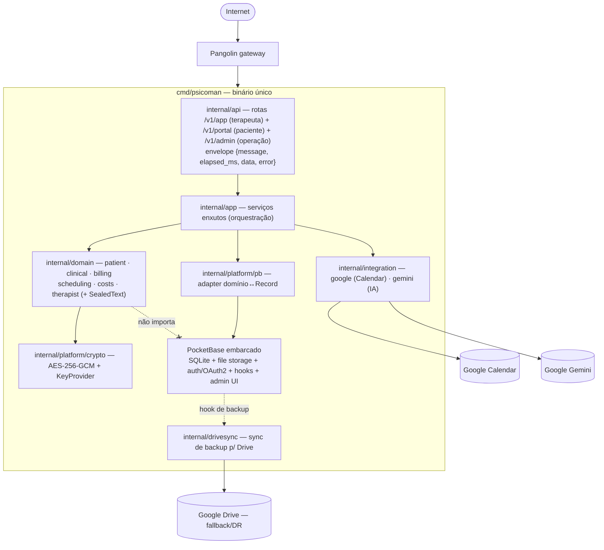
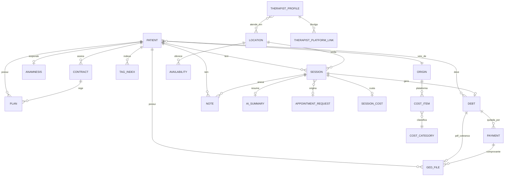

# pocketbase-core — Design

Como realizar os requisitos de [`requirements.md`](./requirements.md), respeitando os padrões da casa e a decisão de arquitetura lastreada em [`docs/decisions.md` (2026-10-21)](../../../docs/decisions.md). A arquitetura canônica em [`docs/architecture.md`](../../../docs/architecture.md) será **reescrita** para este rumo na fase de fechamento das tasks desta onda; até lá, este design é a referência.

Princípios desta onda:
- **Binário único** (`cmd/psicoman`) com o PocketBase embarcado como framework; nada de dois processos.
- **Domínio é a autoridade**: os agregados de domínio não conhecem o PocketBase; o framework fica atrás do adapter `platform/pb`.
- **Cifra no domínio**: o `SealedText` é um tipo de domínio; o PocketBase não é a fronteira de cifra.
- **Contrato próprio `/v1`**: envelope `{ message, elapsed_ms, data, error }`; a REST automática do PocketBase não é o contrato público.
- **Derivar, não reinventar**: aproveitar do PocketBase SQLite relacional, HTTP, file storage, logging, auth/OAuth2, migrations e admin UI.

Arquivos-âncora (estrutura de pastas alvo):
- `cmd/psicoman/main.go` — único; `pocketbase.New()` + `app.OnServe()`.
- `internal/domain/{patient,clinical,billing,scheduling,costs,therapist}` — bounded contexts + o tipo de valor `SealedText`.
- `internal/app` — serviços de negócio enxutos (orquestração).
- `internal/platform/crypto` — AES-256-GCM, envelope do `SealedText`, `KeyProvider`.
- `internal/platform/pb` — adapter domínio↔`Record` do PocketBase (único que conhece o PB).
- `internal/integration/{google,gemini}` — Calendar (síncrono) e Drive (fallback/DR) no `google`; IA no `gemini`. **Gmail fora do escopo** (ver D9.1): a plataforma gera o PDF de cobrança; o envio é feito por fora (WhatsApp).
- `internal/drivesync` — sync de backup para o Drive (fallback/DR).
- `internal/api` — rotas `/v1/*` próprias, envelope PT-BR, sobre o router do PB.

---

## D0. Visão geral (R1, R2, R5)

O binário único fica atrás do `Pangolin`. O PocketBase embarcado provê SQLite, file storage e hooks; as rotas `/v1/*` próprias são registradas sobre o router dele. O fluxo de dependência aponta sempre para o domínio: `api → app → domain`; `platform/pb` é o único a conhecer o PocketBase; o domínio não importa o framework.



**Escolha:** o fluxo de dependência é unidirecional em direção ao domínio; o PocketBase é um detalhe de infraestrutura confinado a `platform/pb` e ao `pbcore` embarcado. Realiza R1, R2, R5.

---

## D1. PocketBase como framework / binário único (R1)

- `cmd/psicoman/main.go` instancia `app := pocketbase.New()` e registra as rotas próprias no hook `app.OnServe()`, que entrega o `*http.ServeMux`/router sobre o qual montamos os grupos por ator `/v1/app/*` (terapeuta), `/v1/portal/*` (paciente) e `/v1/admin/*` (operação técnica) — ver D2 ([doc oficial de routing](https://pocketbase.io/docs/router) — conteúdo rephrased para conformidade de licença).
- Aproveitamos do PocketBase: SQLite relacional com constraints/relations, servidor HTTP, file storage/server, logging, auth/OAuth2, migrations e admin UI. Isso recupera os invariantes transacionais (R1.3) que as alternativas descartadas não davam.
- **Escolha:** a REST automática do PocketBase **não** é o contrato público. Ela pode ficar restrita (via regras de coleção) ou ignorada; o contrato é `/v1/*` (ver D7). Isso evita acoplar clientes ao formato interno das coleções e preserva o envelope próprio.

Realiza R1.1, R1.2, R1.3.

---

## D2. Segregação lógica por ator, em paths que o `Pangolin` divide (R2)

A segregação é por **path por ator**, desenhada para o `Pangolin` aplicar controle de acesso **por prefixo de rota** na borda. Um binário, três superfícies de path bem separadas:

| Path | Ator | Exposição no `Pangolin` | Auth |
|------|------|-------------------------|------|
| `/v1/app/*` | **Terapeuta** (é também a "admin" da instância — single-tenant) | Protegido pelo `Pangolin` (identidade exigida) | Header de identidade injetado pelo `Pangolin` + defense-in-depth no servidor |
| `/v1/portal/*` | **Paciente** | Aberto (só o necessário: cadastro/login + recursos próprios) | Auth do paciente (coleção de auth do PocketBase) + gate de aprovação |
| `/v1/admin/*` | Operação técnica da instância (backup/restore, config) | Protegido pelo `Pangolin`, o mais restrito | Header do `Pangolin` |
| `/_/` (+ `/api/*` do PocketBase) | **Admin UI (Dashboard) do PocketBase** | Protegido pelo `Pangolin`, mesma política de `/v1/admin/*` | Header do `Pangolin` **na borda** + login de superuser do PocketBase (segundo fator) |

- **Terapeuta = admin da instância:** no modelo single-tenant, a terapeuta é a operadora. O path `/v1/app/*` concentra o uso diário dela (pacientes, agenda, prontuário, financeiro). O `/v1/admin/*` e a admin UI nativa (`/_/`) ficam reservados à operação técnica (Dashboard, backup), sob a política de acesso mais estrita no `Pangolin`.
- **Admin UI do PocketBase (`/_/`):** é a SPA Dashboard que o PocketBase serve nativamente, com autenticação **própria** de superuser (não entende o header do `Pangolin` sozinha). Fica sob a **mesma política de borda** do `/v1/admin/*` — só a terapeuta autenticada no `Pangolin` alcança `/_/` — e exige, além disso, o **login de superuser** do PocketBase (segundo fator). Ver D3.
- **Por que paths por ator:** o `Pangolin` divide o controle de acesso **por path**. Prefixos distintos por ator permitem configurar no gateway, por exemplo, "`/v1/portal/*` aberto, `/v1/app/*` e `/v1/admin/*` só para a terapeuta autenticada", sem a aplicação reimplementar auth pesada.
- **Escolha:** segregação por prefixo de rota + middleware, não por processo. Um binário, paths alinhados ao modelo de controle do `Pangolin`. Realiza R2.1, R2.2.

---

## D3. Auth atrás do `Pangolin` + gate de aprovação (R3)

- **Terapeuta (`/v1/app/*`) e operação (`/v1/admin/*`):** a identidade chega por um **header injetado pelo `Pangolin`** (usuário autenticado no gateway). Um middleware nesses grupos lê o header e recusa (401) se ausente — defense-in-depth mesmo confiando no gateway.
- **Portal:** cadastro/login do paciente usam a coleção de auth do PocketBase, expostos só em `/v1/portal/*`.
- **Admin UI do PocketBase (`/_/`) e superuser:** o Dashboard nativo é alcançável apenas pela política de borda do `Pangolin` (mesma de `/v1/admin/*`), e lá a terapeuta faz o **login de superuser** do PocketBase. Não há SSO unificado com o header do `Pangolin`: são dois passos (borda do `Pangolin` + login de superuser). O superuser **pode tudo** nas coleções — mas, como a cifra do prontuário é da **nossa** camada (`SealedText` + `Cipher`, D6), no Dashboard os campos clínicos aparecem como **envelope cifrado**, nunca em claro. Isso é **intencional e desejável**: o Dashboard serve à operação técnica (schema, debug, backup), e o único caminho que expõe clínico em claro continua sendo `/v1/app/*` via DTO + `Reveal()` (D6.3).
- **Gate de aprovação:** o paciente nasce `pendente`; o terapeuta move para `aprovado`/`rejeitado`. O enforcement vive no **middleware do grupo `/v1/portal/*`** (as rotas de recurso são handlers nossos, não a REST do PocketBase — logo o gate tem que estar no nosso middleware, onde a requisição realmente passa): o middleware resolve o paciente pela sessão/email e nega (403) quem não está `aprovado`, exceto as rotas do próprio cadastro/estado. Como reforço, um **hook do PocketBase** nas coleções sensíveis barra escrita de paciente não-aprovado — defesa em profundidade, não o único ponto de controle.
- **Escolha:** gate no middleware da rota (ponto por onde a requisição efetivamente passa) + hook de coleção como reforço; decisão de negócio centralizada e testável por E2E (permitido 2xx, negado 403). Realiza R3.1, R3.2, R3.3.

---

## D4. Domínio rico por bounded context (R4)

- Cada bounded context é um pacote sob `internal/domain`, com agregados que carregam comportamento, serialização e ações. Os serviços em `internal/app` orquestram (abrem transação via porta, chamam o agregado, persistem via `platform/pb`).
- Mapeamento das entidades atuais (de `docs/architecture.md §3`) para os contexts:

| Bounded context | Entidades/agregados |
|-----------------|---------------------|
| `patient`       | paciente, origem/indicação, estado de aprovação |
| `clinical`      | sessão (nota de sessão), nota livre, anamnese, resumo de IA, tags clínicas — campos sensíveis como `SealedText` |
| `billing`       | plano, débito, pagamento, contrato |
| `scheduling`    | pedido de agendamento, ciclo de vida da sessão (status/confirmação/cancelamento) |
| `costs`         | categoria de custo, item de custo, custo de sessão, ROI |
| `therapist`     | perfil do terapeuta, links, locais de atendimento |

- **Escolha:** OO bem feita — comportamento no agregado, serviço enxuto. Um agregado sabe validar-se, transitar de estado e formatar seu log (sem vazar conteúdo clínico). Realiza R4.1, R4.2, R4.3.

---

## D4b. Modelo de dados (MER canônico)

Esta seção é a **fonte de verdade do modelo de dados** da onda `pocketbase-core` — toda coleção do PocketBase (D5) e todo agregado de domínio (D4) derivam daqui. Preserva o modelo maduro das ondas anteriores (`docs/architecture.md §3`) e **adiciona** o que esta onda traz: cifra por campo (`SealedText`), resumo e tags de IA, índice de tags. Convenções: PK `id` **ULID**; dinheiro `int64` centavos BRL; tempo ISO-8601 `America/Sao_Paulo`; soft-delete via `deleted_at` onde aplicável; campos clínicos marcados **🔒 (SealedText)** ficam cifrados em repouso (envelope); o restante em claro e indexável.

### D4b.1 Diagrama entidade-relacionamento



### D4b.2 Entidades por bounded context

**Context `patient`**
- **patient** — `nome`, `telefone`, `email` (obrigatórios; `email` UNIQUE), `cpf` (opcional, UNIQUE quando não nulo), `origin_id` (FK), `approval_status` (`pendente`|`aprovado`|`rejeitado`), `created_at`/`updated_at`/`deleted_at`. Regras: recibo/Receita Saúde exige `cpf`; telefone canônico (só dígitos, DDI 55); cadastro via portal com email existente faz upsert (nunca duplica); gate de aprovação (§D3).
- **origin** — canal de aquisição (Doctoralia, indicação…); pode ligar-se a `cost_item` (plataforma paga) para ROI.

**Context `scheduling`**
- **appointment_request** — `patient_id` (FK), slot solicitado, `status` (`pendente`|`confirmado`|`recusado`). Registro interno; não toca o Google até confirmar.
- **session** — `patient_id` (FK), `location_id` (FK), `modalidade` (`presencial`|`online`), `starts_at`/`ends_at`, `status` (`solicitada`|`agendada`|`confirmada`|`realizada`|`cancelada`|`falta`), flags `bill`/`consider_cost`, `google_event_id`, `meet_url` (↔ `atendimento_url`), metadados de status (`confirmed_at`, `canceled_by` `paciente`|`terapeuta`, `cancel_reason`, `canceled_at`), `contract_id`/`plano_cobranca_id` quando aplicável. Transições e `SessionCategory` preservadas das ondas anteriores.
- **availability** — `location_id` (FK), dia/janela, capacidade. Base das lacunas do portal.
- **location** — `nome`, `endereco`, `modalidade`, `cost_amount` (centavos), `cost_period` (`por_sessao`|`diario`|`mensal`|`anual`).

**Context `clinical`**
- **anamnesis** — `patient_id` (FK, 1:1 UNIQUE), `conteudo` **🔒 (SealedText)**, `updated_at`.
- **note** — `patient_id` (FK), `session_id` (FK, nullable → nota livre), `conteudo` **🔒 (SealedText)**, `created_at` (ordenação por `created_at`).
- **ai_summary** — `session_id` (FK), `resumo` **🔒 (SealedText)**, `status` (`sugerido`|`revisado`|`consolidado`), `generated_at`. Resultado da IA (revisável antes de consolidar).
- **tag_index** — `patient_id` (FK), `ano`, `tag` (claro), `session_ids` (lista). Índice invertido por paciente/ano; tags **em claro** para busca; isolado por paciente (sem cross-paciente).

**Context `billing`**
- **contract** — `patient_id` (FK), vigência (`inicio`/`fim`), regra de reajuste, `plano` associado, referência a artefato (PDF/JSON no GED). *Entidade nova desta onda* (formaliza o que antes era só `plan`).
- **plan** — `patient_id` (FK), `contract_id` (FK, nullable), `tipo` (`pagamento_por_consulta`|`pagamento_por_mes`|`plano_fechado_mensal`|`plano_fechado_trimestral`|`atendimento_social`), `valor` (centavos quando fixo), `due_day` (1–28; 0 = n/a), vigência.
- **debt** — `patient_id` (FK), `session_id` (FK, nullable), `billing_period` (nullable `YYYY-MM`/`YYYY-Q`), `amount` (centavos), `due_date`, `status` (`aberto`|`pago`|`parcial`), `idempotency_key` (**UNIQUE** — geração idempotente). Composição da chave por tipo de plano preservada (§D4b.3).
- **payment** — `debt_id` (FK), `amount` (centavos), `paid_at`, `metodo`.

**Context `costs`**
- **cost_category** / **cost_item** — categorias (`local`|`crp`|`infra`|`plataforma`) e itens com valor + período; `cost_item` de plataforma referencia `origin`.
- **session_cost** — `session_id` (FK, 1:1 UNIQUE), `amount` atribuído, `metodo` (`direto`|`rateio`), snapshot da base do rateio (auditável).

**Context `therapist`**
- **therapist_profile** — um registro por instância: `nome`, `crp`, `email`, `contatos`, `bio`; foto via `ged_file`. Relaciona-se com `location` (atende_em) e `origin`.
- **therapist_platform_link** — `profile_id` (FK), `label`, `url`, `origin_id` (FK nullable).

**Transversais**
- **ged_file** — `patient_id`/`session_id`/`debt_id`/`payment_id` (FK nullable), `path`, `mime`, `size`, `sha256` (integridade + dedup), `created_at`. Arquivos (PDF de cobrança, comprovantes, foto) servidos pelo file storage do PocketBase.
- **audit_log** — `actor` (email), `acao`, `entidade`, `entity_id`, `timestamp`, metadados **sem conteúdo clínico**. Ações sensíveis: prontuário (leitura/escrita), débito, config, backup/restore, `ai.process`, aprovação de paciente.
- **google_token** — refresh token **cifrado**, escopos, expiry. (Settings sensíveis podem usar o `PB_ENCRYPTION_KEY` do PocketBase; o conteúdo clínico usa o nosso `SealedText`.)
- **(coleção de auth do paciente)** — provida pelo PocketBase (OAuth/login do portal), vinculada ao `patient` por email verificado.

### D4b.3 Regras de modelo que o schema deve impor (não só a app)

- **UNIQUE:** `patient.email`; `patient.cpf` (parcial, quando não nulo); `debt.idempotency_key`; `session_cost.session_id`; `anamnesis.patient_id`.
- **Idempotência de débito:** `idempotency_key = session_id` (planos por sessão) ou `plan_id + billing_period` (planos fechados); `atendimento_social` nunca gera `debt` (barrado na camada de serviço).
- **FK/relations:** conforme o diagrama (D4b.1). O PocketBase modela como `relation` entre coleções.
- **Cifra em repouso:** colunas 🔒 guardam o **envelope** do `SealedText`, nunca o claro.

Realiza R11.1, R11.2 e lastreia D5 (coleções) e R4.2 (bounded contexts).

---

## D5. Ports & Adapters — `platform/pb` (R5)

- O domínio/app define **interfaces de porta** (repositórios), por exemplo:

```go
// Porta de persistência de paciente, definida no domínio/app.
// O domínio NÃO conhece o PocketBase.
type PatientRepository interface {
    Create(ctx context.Context, p *patient.Patient) error
    GetByID(ctx context.Context, id string) (*patient.Patient, error)
    GetByEmail(ctx context.Context, email string) (*patient.Patient, error)
}
```

- O adapter concreto vive em `internal/platform/pb` e é o **único** que importa o PocketBase; ele traduz entre o agregado de domínio e o `core.Record` do PocketBase (leitura/escrita de campos). Ao gravar um campo clínico, o adapter cifra via a interface `Cipher` (D6.3), persistindo o **envelope** como string; ao ler, decifra para `SealedText` em memória.
- **Padrão geral de desacoplamento (toda lib externa):** o mesmo princípio vale para qualquer dependência externa que não deva vazar para o domínio — o domínio conhece só uma **interface** (porta); a implementação que encapsula a lib vive em `platform/*` ou `integration/*`:
  - persistência → interface de repositório; adapter `platform/pb` (PocketBase).
  - cifra → interface `Cipher`; adapter `platform/crypto` (AES-256-GCM / `security` do PocketBase).
  - agenda → interface de Calendar; adapter `integration/google`.
  - IA → interface de resumo/tags; adapter `integration/gemini`.
- **Escolha:** manter a autoridade no domínio e toda lib externa atrás de uma porta. Trocar o PocketBase (ou a cripto, ou o provedor de IA) por outra implementação = reescrever só o adapter correspondente, sem tocar domínio/serviços. Realiza R5.1, R5.2.

---

## D6. Cripto por campo — `SealedText` + interface `Cipher` (R6)

Esta seção foi **refinada** após a validação da spec (ver `docs/decisions.md`, nota à ADR 2026-10-21): a cifra passa a ser acessada pelo domínio **por uma interface** (`Cipher`), e a fronteira onde o texto é cifrado/decifrado é o **adapter de persistência** (`platform/pb`) — não há `MarshalJSON` "mágico". Isso elimina o acoplamento do domínio à lib de cripto e resolve a tensão de leitura do prontuário (D6.3).

### D6.1 Interface `Cipher` no domínio; implementação encapsula a lib

O domínio conhece **apenas a interface** `Cipher`. A implementação concreta encapsula o primitivo de cifra (podendo usar o módulo `security` do PocketBase ou `crypto/aes` direto) — o domínio não importa nenhum dos dois.

```go
// internal/domain (porta): o domínio só conhece esta interface.
type Cipher interface {
    // Seal cifra o claro e devolve o envelope versionado (string).
    Seal(ctx context.Context, plaintext string) (string, error)
    // Open decifra o envelope e devolve o claro (resolve a chave pelo id no envelope).
    Open(ctx context.Context, envelope string) (string, error)
}

// internal/platform/crypto (adapter): implementação concreta.
// Encapsula o primitivo (AES-256-GCM) e o KeyProvider; monta/parseia o envelope.
// O domínio NÃO importa este pacote nem o PocketBase.
type aesCipher struct { keys KeyProvider }

// KeyProvider resolve a chave por id (rotação) e informa o id corrente.
type KeyProvider interface {
    Key(id string) ([]byte, error)
    CurrentID() string
}
```

- **Regra geral (Ports & Adapters para libs externas):** sempre que uma lib externa não fizer sentido no domínio (cripto, PocketBase, Google, Gemini), o domínio conhece **só uma interface**; a implementação concreta que encapsula a lib vive em `platform/*` ou `integration/*`. Isso mantém o domínio puro e testável com fakes.

### D6.2 `SealedText`: valor de domínio, sem serialização mágica

`SealedText` é um **valor de domínio** que carrega o texto clínico em **claro em memória** (durante a vida do agregado) e sabe se **selar** (produzir o envelope) e **abrir** via a `Cipher` injetada no serviço. Ele **não** tem `MarshalJSON` que cifra sozinho — a decisão de cifrar/decifrar é explícita, no adapter de persistência.

```go
// SealedText: valor de domínio para texto clínico sensível.
// Carrega o claro em memória; a cifra é explícita, via Cipher, na borda de persistência.
type SealedText struct {
    plaintext string // claro em memória; nunca serializado direto para fora
}

func NewSealedText(s string) SealedText        // a partir do claro (em memória)
func (t SealedText) String() string            // uso interno controlado; NÃO é serialização de saída
func (t SealedText) Reveal() string            // claro explícito (para montar DTO de leitura do admin)

// Conversões de borda (usadas SÓ pelo adapter platform/pb):
func SealFor(ctx, c Cipher, t SealedText) (envelope string, err error) // cifra ao gravar
func OpenInto(ctx, c Cipher, envelope string) (SealedText, error)       // decifra ao ler
```

- **Não-vazamento:** `SealedText` **não implementa `MarshalJSON`** que exponha o claro. A saída para a API nunca serializa `SealedText` diretamente — vai por DTO explícito (D6.3). Um teste garante que o tipo não tem um caminho de serialização que emita o claro acidentalmente.

### D6.3 Onde cifra/decifra acontece — adapter de persistência + DTOs na API

Este é o ponto que a validação mandou repensar. A cifra é **responsabilidade do adapter `platform/pb`**, não de um `MarshalJSON`:

- **Escrita (gravar prontuário):** `app` monta o agregado com `SealedText` em claro → chama a porta do repositório → `platform/pb` chama `SealFor(ctx, cipher, campo)` e grava o **envelope** na coluna do PocketBase. O claro nunca toca o disco.
- **Leitura (abrir prontuário):** `platform/pb` lê o envelope da coluna → `OpenInto(ctx, cipher, envelope)` → devolve o agregado com `SealedText` em claro em memória.
- **Resposta da API:** o handler monta um **DTO de resposta explícito**. Para o admin/terapeuta, o DTO inclui o campo clínico em claro via `Reveal()` (a terapeuta precisa ler o prontuário — este é o fluxo central). Para o portal do paciente, **nenhum DTO inclui campo clínico** — o portal nunca recebe prontuário.
- **Em repouso:** no banco só existe o envelope cifrado; a REST automática do PocketBase, se tocada, devolveria o envelope (ilegível), nunca o claro (D13 tem o teste de contrato que garante isso).

Resolve a tensão de leitura: o admin lê o claro por um caminho **explícito e auditável** (DTO + `Reveal`), e não há serialização automática que possa vazar.

### D6.4 Envelope e rotação

- **Envelope:** `versao_do_esquema.algoritmo.id_da_chave.nonce.ciphertext` (campos em base64, separados por ponto), montado/parseado dentro de `platform/crypto`. O `id_da_chave` habilita **rotação**; `versao_do_esquema`/`algoritmo` habilitam evoluir o algoritmo sem quebrar dados antigos. Algoritmo **AES-256-GCM**.
- O PocketBase expõe `security.Encrypt(data, key)` / `security.Decrypt(cipherText, key)` (AES-256-GCM, chave de 32 chars) — o `aesCipher` pode usá-lo ou `crypto/aes` direto; de qualquer forma fica **atrás da interface `Cipher`**, invisível ao domínio. O PocketBase **não** cifra arquivo/DB sozinho — a cifra é do nosso adapter ([`tools/security/encrypt.go`](https://github.com/pocketbase/pocketbase/blob/master/tools/security/encrypt.go) — rephrased para conformidade de licença).

### D6.5 Cifra por campo, busca por tags

- A cifra é **por campo**: só os campos clínicos sensíveis (corpo da sessão, anamnese, notas, resumo de IA) são `SealedText`. Nome, email, telefone, datas, status e valores ficam em claro e indexáveis.
- A busca clínica se dá pelas **tags** (claro) — ver D10 —, nunca pelo corpo cifrado.

Realiza R6.1, R6.2, R6.3, R6.4, R6.5.

---

## D7. Contrato de API `/v1` (R2, R7)

- Rotas versionadas sob `/v1/*`, segregadas por ator (D2): `/v1/app/*` (terapeuta), `/v1/portal/*` (paciente), `/v1/admin/*` (operação técnica), registradas no `app.OnServe()`.
- Envelope de resposta `{ message, elapsed_ms, data, error }` (`message` em PT-BR). Exemplo de sucesso:

```json
{
  "message": "Sessão criada com sucesso.",
  "elapsed_ms": 12,
  "data": {
    "id": "01JBX8Z0K3M9R2V7Q4T6N5W8AE",
    "patient_id": "01JBX7Y...",
    "starts_at": "2026-10-21T14:00:00-03:00",
    "modalidade": "online",
    "status": "agendada"
  },
  "error": null
}
```

Exemplo de erro:

```json
{
  "message": "Não foi possível agendar: horário em conflito.",
  "elapsed_ms": 8,
  "data": null,
  "error": { "code": "conflito_de_horario" }
}
```

- **Middleware chain** (equivalente ao que o projeto já usa): recover → request-id → timing (preenche `elapsed_ms`) → logging → auth por ator (header do `Pangolin` em `/v1/app` e `/v1/admin`; sessão de paciente + gate de aprovação em `/v1/portal`) → handler.
- **Exemplos de rota:**
  - `POST /v1/app/sessions` — terapeuta cria/agenda uma sessão (checa conflito via Calendar, D8).
  - `GET /v1/app/patients/{id}/debts` — terapeuta lista débitos do paciente.
  - `GET /v1/portal/me` — paciente consulta o próprio cadastro (fora do gate).
  - `POST /v1/admin/backup` — operação técnica dispara backup (path mais restrito).
- **Swagger:** o contrato `/v1/*` é descrito em OpenAPI, mantido no mesmo ciclo da mudança de contrato.
- **Escolha:** contrato próprio `/v1` com envelope, sobre o router do PocketBase; a REST automática do PB não é exposta como contrato. Realiza R2.1, R7.1, R7.2, R7.3.

---

## D8. Integração Google Calendar (síncrona) (R8)

- `internal/integration/google` expõe o Calendar via interface + fake (para teste), seguindo o padrão do projeto.
- QUANDO o terapeuta agenda/confirma: checa conflito via `freebusy`, cria o evento e, se online, gera o link do Meet — tudo **síncrono**, no caminho de request. É o único Google no caminho de request.
- QUANDO não há credenciais ou o Google está indisponível: degrada sem panic (no-op de evento + aviso no boot/log), coerente com o `dev_mode`.
- **Escolha:** manter o Calendar síncrono atrás de interface + fake preserva testabilidade e o comportamento degradado já estabelecido. Realiza R8.1.

---

## D9. Google Drive como fallback/DR (`drivesync`) (R9)

- O Drive sai do caminho de request. Um **hook no ciclo de backup** do PocketBase dispara o sync do snapshot para uma pasta fria no Drive (`internal/drivesync`), podendo rodar como segundo processo/hook.
- Escopo OAuth mínimo (`drive.file`); o snapshot é cifrado antes do upload. O Drive nunca é fonte da verdade nem caminho de request.
- **Escolha:** acoplar o sync ao evento de backup do PocketBase (em vez de um cron próprio) garante que o espelho de DR acompanha os snapshots reais, sem lógica de sync bidirecional. Realiza R9.1, R9.2.

---

## D9b. Cobrança: geração de PDF (Gmail fora do escopo) (R9)

Refinamento da validação: o envio de cobrança por **Gmail sai do escopo**. Na prática, a terapeuta envia a cobrança por **WhatsApp**, fora da plataforma.

- A plataforma **gera o PDF de cobrança** a partir do débito (itens, valor, vencimento, dados do paciente/terapeuta) e o armazena no GED (`ged_file`, servido pelo file storage do PocketBase). Isso é suficiente: a terapeuta baixa/compartilha o PDF por fora.
- **Não há** integração de envio de email (Gmail) nesta arquitetura. O `internal/integration/google` cobre apenas Calendar (síncrono) e Drive (fallback/DR).
- Comprovantes de pagamento enviados pelo paciente continuam anexáveis ao `payment`/GED como hoje.
- **Escolha:** gerar o artefato (PDF) e deixar o canal de envio (WhatsApp) com a terapeuta remove uma integração (Gmail) e seus modos de falha, sem perder a funcionalidade real (ter o documento de cobrança). Realiza R9 (escopo de cobrança).

---

## D10. IA Gemini + índice de tags (R10)

- `internal/integration/gemini` (interface + fake) faz resumo clínico + tagueamento. Disparo **explícito** pelo terapeuta; resultado **revisável** antes de consolidar.
- **Índice invertido de tags por paciente/ano** (`tag -> lista de IDs de sessão`), isolado por paciente — inspirado no modelo de `/tmp/evolucao-ref.md §3.2/§7.4`, porém com uma diferença essencial ao novo rumo: as **tags ficam em claro** (indexáveis) enquanto o corpo clínico é `SealedText` (cifrado). O Drive **não** é fonte da verdade; o índice vive em coleção do PocketBase.
- **Opt-in por instância**, default **off**. Auditoria `ai.process` **sem conteúdo clínico** nos metadados; minimização dos dados enviados. Base legal: os dados são da própria terapeuta (controladora), que já faz esse trabalho manualmente — a IA assiste.
- **Escolha:** tags em claro + corpo cifrado é o que torna a busca clínica viável sem expor conteúdo; o índice invertido por paciente/ano evita varredura cara. Realiza R10.1, R10.2, R10.3, R10.4.

---

## D11. Configuração (R1, R6, R8, R9, R10)

- **Cifra:** chave via config atrás do `KeyProvider` (`id_da_chave` corrente + chaves anteriores para rotação). Nenhuma chave em claro no repositório.
- **PocketBase:** `data dir` do PB, credenciais OAuth do Google (Calendar/Drive), parâmetros do admin UI.
- **Gemini:** flag `on/off` (default off) + chave da API, por instância.
- **Escolha:** configuração única do binário (arquivo de config + variáveis de ambiente), coerente com o roll out de um artefato só. Realiza R1.2, R6.4, R8.1, R9.2, R10.3.

---

## D12. Trade-offs

| Decisão | Escolha | Motivo |
|---------|---------|--------|
| Framework de base | PocketBase como framework (lib Go) | Recupera SQLite relacional + HTTP + file storage + auth + migrations + admin num binário só, sem reescrever infraestrutura à mão (R1). |
| Topologia de processo | Binário único | Roll out simples (um artefato); tudo roda atrás do `Pangolin`, então segregar em processos não traz ganho (R1, R2). |
| Cifra | Por campo (`SealedText`) | Mantém nome/datas/valores/tags indexáveis e cifra só o clínico sensível; preserva busca por tags (R6). |
| Acoplamento ao PocketBase | Adapter `platform/pb` (Ports & Adapters) | Domínio permanece autoridade; trocar o PB = reescrever só o adapter (R5). |
| Contrato de API | Rotas próprias `/v1` + envelope | Contrato estável e didático, desacoplado do formato interno das coleções; REST automática do PB não é pública (R7). |
| Google Drive | Fallback/DR via hook de backup | Evita sync bidirecional e Drive no caminho de request (fragilidade das alternativas descartadas) (R9). |
| IA Gemini | Opt-in, default off, revisável | Minimização e controle da terapeuta sobre o processamento clínico (R10). |
| Implementação da cifra | `crypto/aes`+`crypto/cipher` no `platform/crypto` | Controle do envelope versionado e da rotação por `id_da_chave`; `security.Encrypt` do PB como referência do mesmo primitivo (R6). |

---

## D13. Estratégia de testes (R4, R6, R7, R11)

- **Domínio (unit):** comportamento dos agregados por bounded context (transições de status da sessão, validações, idempotência financeira). `SealedText`: **round-trip** (o claro é selado no adapter via `Cipher`, persistido como envelope, lido e decifrado de volta por `Reveal`) e **não-vazamento** (`SealedText` **não** tem `MarshalJSON` que exponha o claro; a saída vai por DTO explícito; o log do agregado não expõe conteúdo clínico). Rotação: decifrar com `id_da_chave` antigo após trocar o corrente.
- **Serviços (unit):** `internal/app` com fakes das portas (repositórios, Calendar, Gemini) — idempotência de débito, categorização, gate de aprovação.
- **E2E sobre o binário único:** request HTTP real contra `/v1/*`, Google e Gemini **mockados**. Cobrir caminho permitido (2xx) e negado (403/401) do gate de aprovação (R3).
- **Teste de contrato de exposição:** garantir que a **REST automática do PocketBase não expõe dado clínico** em claro (o campo persistido é o envelope cifrado); o contrato público é `/v1/*`, e nenhuma resposta serializa `SealedText` direto — o clínico só sai em claro pelo DTO do ator app via `Reveal()` (D6.3).
- **Migração de coleções no boot:** aplicar as migrations do PocketBase em base nova e idempotente; conferir constraints/relations (UNIQUE de email/CPF, FK, chave de idempotência).

Cada estratégia acima cobre os requisitos citados; nenhum `t.Skip` sem justificativa no próprio teste (ver [`.kiro/steering/psicoman-processo-entrega.md`](../../steering/psicoman-processo-entrega.md)).
