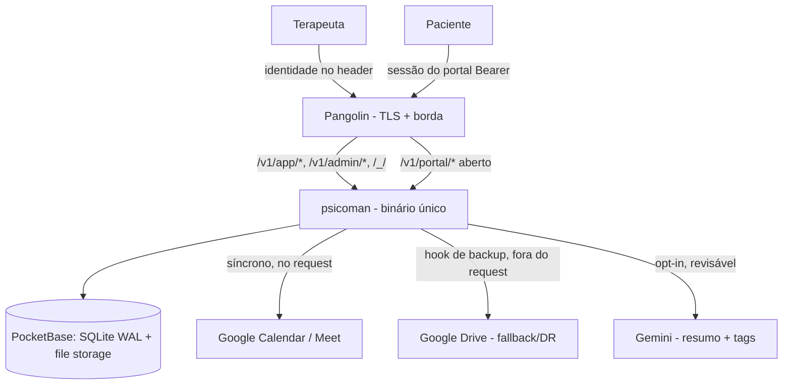

# Psicoman

Sistema de gestão de atendimentos para psicologia — pacientes, agenda, sessões, prontuário, financeiro e custos, com portal self-service para o paciente. **Single-tenant:** uma instância isolada por terapeuta.

---

## Contexto

Um terapeuta precisa de uma ferramenta única para conduzir o consultório: cadastro de pacientes, agenda integrada ao Google Calendar/Meet, prontuário clínico, cobranças, custos e retorno dos canais de aquisição (ex.: Doctoralia). O Psicoman é uma solução **simples, auto-contida e de baixa manutenção**, para rodar em infraestrutura própria e segregada — uma **VM por terapeuta**.

## Arquitetura em uma frase

**Um único binário Go** com o [PocketBase](https://pocketbase.io) embarcado **como framework** (SQLite relacional, servidor HTTP, file storage, auth/OAuth2, migrations e admin UI nativa em `/_/`), rodando **sempre atrás do [Pangolin](https://docs.fossorial.io/)** (gateway que termina TLS e injeta identidade). As rotas próprias `/v1/*` são registradas no hook `app.OnServe()`.



### Princípios estruturais

- **Domínio rico por bounded context** em `internal/domain/{patient,clinical,billing,scheduling,costs,therapist}`; serviços enxutos em `internal/app`; portas (interfaces de repositório) em `internal/app/ports.go`.
- **Regra de dependência (testada por `internal/archtest`):** `internal/domain` e `internal/app` **não** importam o PocketBase; o adapter `internal/platform/pb` é o **único** que o importa; `internal/config` é um pacote de borda puro.
- **Cifra por campo (`SealedText`):** o prontuário clínico (corpo da sessão, anamnese, notas, resumo de IA) é cifrado **por campo** (AES-256-GCM) na borda de persistência. O `SealedText` carrega o claro só em memória, não tem `MarshalJSON` que o exponha, e a API responde **sempre por DTO explícito** — o claro só sai pelo ator terapeuta via `Reveal()`. Nem o superuser vê clínico em claro pela REST nativa (envelope cifrado em repouso).
- **Contrato `/v1` por ator:** `/v1/app` (terapeuta), `/v1/portal` (paciente, aberto), `/v1/admin` (operação). Envelope de resposta `{ message, elapsed_ms, data, error }` em PT-BR. A REST automática do PocketBase **não** é contrato público (coleções trancadas). Swagger em `/v1/swagger`.
- **Padrões não-negociáveis:** ULID em toda entidade; dinheiro em `int64` centavos; tempo `America/Sao_Paulo` ISO-8601; erros ao usuário em PT-BR; segredos nunca em log nem no repositório.

## Atores e autenticação

| Path | Ator | Auth |
|------|------|------|
| `/v1/app/*` | Terapeuta (também a operadora, no single-tenant) | Header de identidade injetado pelo Pangolin (401 se ausente) |
| `/v1/portal/*` | Paciente | Sessão própria (coleção de auth `patient_user` do PocketBase) + **gate de aprovação** |
| `/v1/admin/*` | Operação técnica (backup, auditoria) | Header do Pangolin |
| `/_/` (admin UI nativa) | Operação técnica | Política de borda do Pangolin + login de superuser do PocketBase |

**Gate de aprovação:** o paciente se auto-cadastra e nasce `pendente`; não acessa recurso algum até o terapeuta aprovar (imposto no servidor, HTTP 403, com hook de reforço de defesa em profundidade). O `/v1/portal/*` é aberto no Pangolin (só TLS); a autenticação do paciente é da própria aplicação.

## Integrações

- **Google Calendar/Meet** — síncrono, **único Google no caminho de request**. Antes de confirmar uma sessão, consulta o `freebusy` (conflito → 409); cria o evento com o paciente convidado e reminders; Meet quando a sessão é online. Sem credenciais, degrada (agenda sem evento, sem derrubar). Escopo OAuth mínimo: `calendar`.
- **Google Drive** — **fallback/DR**, nunca fonte da verdade. Um hook no ciclo de **backup** do PocketBase cifra o snapshot (AES-256-GCM) e o envia a uma pasta fria no Drive, fora do caminho de request. Escopo mínimo: `drive.file`. Sem credenciais, o backup local segue (no-op observável).
- **Cobrança em PDF** — gerada a partir do débito (Go puro, sem dependência) e armazenada no GED (file storage do PocketBase), com dedup por SHA-256. **Sem envio por email** — o canal é a terapeuta (WhatsApp), fora da plataforma. Gmail fora de escopo.
- **IA (Gemini)** — **opt-in pela presença da chave** `llm.gemini.api_key` (default off). Resumo clínico + tags por **disparo explícito** do terapeuta, **revisável** antes de consolidar. Auditoria `ai.process` sem conteúdo clínico (minimização). Índice invertido de tags por paciente/ano: tags em **claro** (busca), corpo clínico **cifrado**, isolado por paciente.

## Stack

- **Linguagem:** Go · **Framework/infra:** PocketBase embarcado (SQLite WAL, HTTP, file storage, auth, migrations, admin UI)
- **Moeda:** BRL (centavos, `int64`) · **Fuso:** `America/Sao_Paulo` · **IDs:** ULID
- **Cifra:** AES-256-GCM por campo (`SealedText`) + snapshot de backup cifrado

## Build e execução

```bash
make build        # compila UM binário em bin/psicoman
make check        # gate: fmt + vet + build + testes unit + e2e
make test-unit    # só testes unitários
make e2e          # só testes end-to-end

# executar (atrás do Pangolin, em produção):
bin/psicoman serve --http 127.0.0.1:8090 --dir ./pb_data
```

A configuração vem de um `config.yaml` (ver `config.example.yaml`): cifra, header do Pangolin, credenciais Google e chave do Gemini. **Variáveis de ambiente sobrescrevem o arquivo**; a origem de cada chave é logada no boot, sem vazar segredos. A admin UI nativa do PocketBase fica em `/_/`.

## Documentação

| Documento | Conteúdo |
|-----------|----------|
| [`docs/requirements.md`](./docs/requirements.md) | O quê/por quê — requisitos de produto |
| [`docs/architecture.md`](./docs/architecture.md) | Como — estrutura, coleções, contratos, integrações |
| [`docs/decisions.md`](./docs/decisions.md) | Registro de decisões (ADR leve) |
| [`docs/deploy.md`](./docs/deploy.md) | Instalação e operação |
| [`docs/release-notes.md`](./docs/release-notes.md) | Notas de versão por onda |
| [`.kiro/specs/pocketbase-core/`](./.kiro/specs/pocketbase-core/) | Spec da onda atual (requirements/design/tasks) |

## Segurança e privacidade

- Prontuário é dado sensível de saúde: cifra por campo em repouso (`SealedText`), snapshot de backup cifrado, audit log de operações sensíveis (sem conteúdo clínico), infra segregada (uma VM por terapeuta).
- Defesa em profundidade: toda regra sensível é imposta no servidor, mesmo com o Pangolin na frente.
- Segredos (chave de cifra, client secret OAuth, refresh tokens, chave Gemini) nunca em log, resposta de erro ou código — só via `config.yaml` (fora do repo) ou env.

## Status

Onda `pocketbase-core` implementada e verde: binário único com PocketBase embarcado, cifra por campo, contrato `/v1` por ator, Calendar síncrono, PDF de cobrança no GED, Drive como DR, Gemini opt-in com índice de tags e portal do paciente com auth própria. `make check` passa (fmt + vet + build + unit + e2e).
