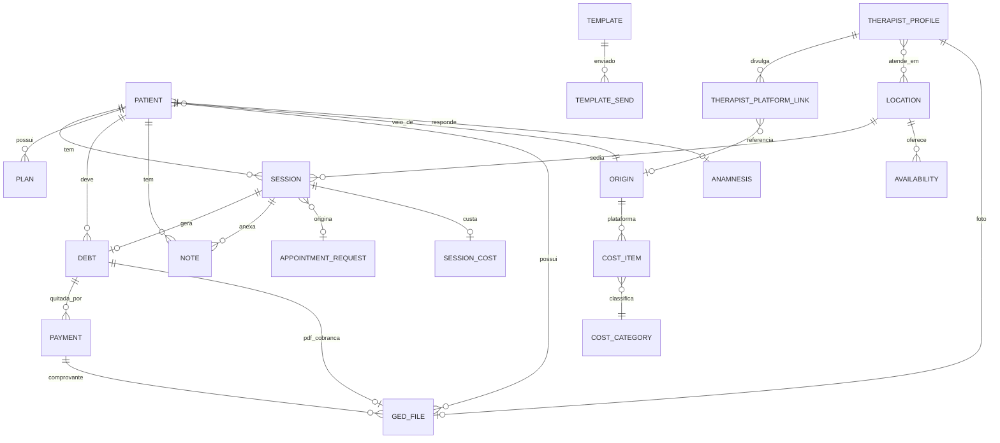
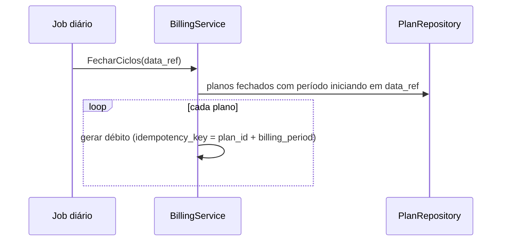
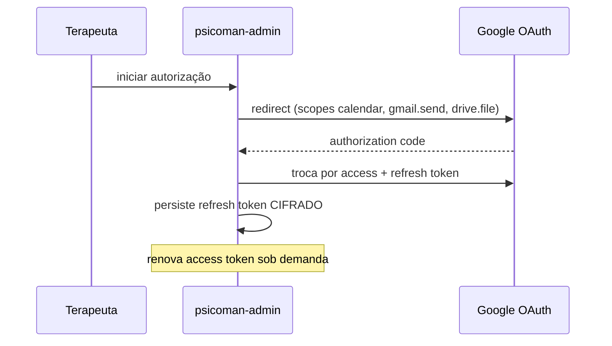

# Psicoman — Documento de Design
# Psicoman — Arquitetura

Design técnico da plataforma. Complementa [`requirements.md`](./requirements.md) (requisitos) e antecede [`../.kiro/specs/mvp/tasks.md`](../.kiro/specs/mvp/tasks.md) (plano de implementação).

> **Onda `pocketbase-core` em curso.** As seções numeradas 1–9 abaixo descrevem a arquitetura anterior (dois binários, domínio magro, repositório SQLite próprio) e **serão reescritas na Fase 10** da onda. Até lá, a seção **0 (abaixo)** documenta o incremento já entregue por esta onda. A decisão-base está na ADR `2026-10-21` de [`decisions.md`](./decisions.md).

---

## 0. Onda `pocketbase-core` — domínio rico por bounded context (Fase 2)

Incremento entregue pela Fase 2 da onda `pocketbase-core`. Cobre a camada de domínio (agregados ricos) e a camada de aplicação (serviços enxutos + portas). A fundação do binário único (Fase 0) e a cifra por campo `SealedText` (Fase 1) já estão na base; as coleções/adapter `platform/pb` (Fase 3) e o contrato `/v1` (Fase 4) chegam nas fases seguintes. Fonte do modelo de dados: D4b (MER canônico) em [`../.kiro/specs/pocketbase-core/design.md`](../.kiro/specs/pocketbase-core/design.md).

### 0.1 Camadas e regra de dependência

```
internal/domain/<context>   núcleo de regras (agregados ricos) — não importa PB, app, api
      ↑ (interfaces de porta tipadas contra o domínio)
internal/app                serviços enxutos + portas de repositório/integração
      ↑
internal/platform/pb        adapter (Fase 3) — único a importar o PocketBase
```

- **Domínio puro.** `internal/domain/*` só pode acoplar-se a `internal/platform/{ulid,clock}` e aos tipos transversais `domain.Cipher`/`domain.SealedText`. **Não** importa o PocketBase, `platform/pb`, `app` nem `api`. Imposto pelo teste de arquitetura `internal/archtest/arch_test.go` (`TestDomainNaoImportaPocketBase`), parte do gate.
- **Serviços enxutos.** `internal/app` orquestra os agregados e depende apenas das **portas** (interfaces), nunca de uma lib externa concreta. A lógica de negócio vive no agregado; o serviço só coordena I/O, auditoria e disparo de hooks.
- **Portas em `internal/app`.** As interfaces de repositório e de integração ficam em `internal/app` (não no domínio), junto do serviço que as consome (`internal/app/ports.go`). Mantém o domínio como núcleo puro, sem portas órfãs. O adapter `platform/pb` (Fase 3) implementa essas portas.

### 0.2 Bounded contexts

Seis contexts, cada um um pacote Go com seus agregados, validação, transições e funções puras:

| Context (`internal/domain/…`) | Agregados / tipos principais | Responsabilidade |
|---|---|---|
| `patient` | `Patient`, `Origin` | Cadastro, telefone/CPF canônico, gate de aprovação (`pendente`/`aprovado`/`rejeitado`), emissão de recibo. |
| `scheduling` | `Session`, `Location`, `Availability`, `AppointmentRequest` | Ciclo de vida da sessão (transições, confirmação, cancelamento com autor/motivo, remarcação) e `SessionCategory`. **Kernel compartilhado:** dono das constantes de `modalidade`, `período` e categoria de sessão. |
| `billing` | `Contract`, `Plan`, `Debt`, `Payment` | Débito por sessão (opt-out `bill`), fechamento de ciclo por `due_day` com idempotência (`session_id` ou `plan_id+billing_period`), `atendimento_social` nunca gera débito, status de pagamento (`aberto`/`parcial`/`pago`). |
| `costs` | `CostCategory`, `CostItem`, `SessionCost`, ROI | Custo direto/rateado por sessão, rateio por período, ROI por origem. |
| `clinical` | `Anamnesis`, `Note`, `AISummary`, `TagIndex`, timeline, métricas | Prontuário com campos clínicos em `SealedText`; timeline/métricas derivadas; tags do `tag_index` em **claro** (indexáveis), corpo cifrado. |
| `therapist` | `TherapistProfile`, `TherapistPlatformLink` | Perfil do terapeuta e links de plataformas (reusa `origin`). |

**Dependências entre contexts (unidirecionais e explícitas):**

- `scheduling` é o **kernel compartilhado**: não importa nenhum context irmão.
- `costs → scheduling` — para as constantes de período (`PeriodDiario/Mensal/Anual`) usadas no rateio.
- `clinical → scheduling` — o motor de métricas consome `scheduling.SessionCategory`.
- `clinical → billing` — a timeline referencia débitos/pagamentos do paciente.
- Onde um serviço precisa cruzar contexts sem criar import (ex.: finalizar sessão → gerar débito), a orquestração vive em `internal/app`, passando dados primitivos (IDs, valores, flags) em vez de importar o pacote irmão.

Transversais no pacote raiz `internal/domain`: `AuditLog` (`audit.go`), `GEDFile` (`ged.go`), além de `Cipher`/`SealedText` (Fase 1). Mantidos na raiz por não carregarem regra de um context específico.

### 0.3 Serviços de aplicação (`internal/app`)

Serviços enxutos, um por área, recebendo as portas por injeção (construtores `New…Service`) e um `clock.Clock` injetável para testes determinísticos: `SessionService`, `BillingService`, `PaymentService`, `CostService`, `ReportService`, `SessionMetricsService` (via `metrics_service.go`), `HistoryService`, `DayFeedService`, `PatientService`, `AuditService`. As regras de negócio maduras das ondas anteriores foram **portadas** (não reinventadas) para os agregados + serviços, com paridade de comportamento verificada por testes unitários (feliz + borda) usando fakes das portas.

### 0.4 Invariantes de domínio preservados

ULID em toda entidade (`internal/platform/ulid`), dinheiro em `int64` centavos BRL, instantes em `America/Sao_Paulo` via `internal/platform/clock`, erros ao usuário em PT-BR (sentinelas `ErrNotFound`/`ErrConflict`/`ErrValidation` em `internal/app/errors.go`), `context.Context` como 1º parâmetro de toda porta/serviço com I/O, e idempotência de efeito financeiro por chave única.

### 0.5 Coleções/migrations e adapter `platform/pb` (Fase 3)

A Fase 3 materializa a camada de persistência: as **coleções do PocketBase** derivadas do MER canônico (D4b) e o **adapter** `internal/platform/pb`, único pacote que importa o PocketBase e que implementa as portas de `internal/app/ports.go`. O domínio continua limpo (archtest verde; `go list -deps ./internal/domain/...` sem `pocketbase`/`platform/pb`).

**Coleções e migrations.** As coleções vivem no subpacote `internal/platform/pb/migrations`, um arquivo por grupo do MER, cada um registrado via `migrations.Register(up, down, nome)` em `init()` e aplicado no boot por `RunAllMigrations()` (idempotente: reexecução é no-op). `cmd/psicoman/main.go` faz o blank import do subpacote. Os três grupos:

- `0010_patient_scheduling` — `origin`, `location`, `patient`, `availability`, `appointment_request`, `session`.
- `0020_billing_costs` — `cost_category`, `cost_item`, `contract`, `plan`, `debt`, `payment`, `session_cost` (ciclos `contract↔plan` e `session→contract/plan` resolvidos por patch de relation após ambas as coleções existirem).
- `0030_clinical_therapist_transversais` — `anamnesis`, `note`, `ai_summary`, `tag_index`, `therapist_profile`, `therapist_platform_link`, `ged_file`, `audit_log`, `google_token`.

**Convenções do schema (psicoman-sqlite.md):**

- **`id` ULID custom.** Em cada coleção o campo `id` default do PocketBase (15 chars `[a-z0-9]`, autogerado) é substituído por um `TextField{PrimaryKey, System, Required, Min:26, Max:26, Pattern:"^[0-9A-HJKMNP-TV-Z]{26}$"}` **sem** `AutogeneratePattern`. O PB não autogera; o adapter grava o ULID do agregado via `rec.Set("id", agg.ID)`. `initIdField` respeita o `id` pré-existente.
- **Timestamps TEXT ISO-8601.** `created_at`/`updated_at`/`deleted_at` são `TextField` serializados pela aplicação (`clock.Format` = RFC3339 em America/Sao_Paulo), nunca `AutodateField` nem `DEFAULT CURRENT_TIMESTAMP` (que usa UTC). `deleted_at` vazio = ativo.
- **Dinheiro** em `NumberField{OnlyInt:true}` (centavos).
- **Constraints.** UNIQUE `email` e UNIQUE parcial `cpf` em `patient`; UNIQUE `idempotency_key` em `debt` (idempotência de efeito financeiro); UNIQUE `session_id` em `session_cost` (1:1); UNIQUE `patient_id` em `anamnesis` (1:1).

**Adapter (um repositório por porta).** Cada repositório é um struct com um `core.App` (e um `domain.Cipher` nos que têm campo clínico). Mapeia agregado↔`core.Record` via `rec.Set(...)` (gravação) e `rec.GetString/GetInt64/GetBool` (leitura), propagando `context.Context` por `SaveWithContext`/`DeleteWithContext`. Erros do PocketBase são traduzidos para os sentinelas de `internal/app`: `sql.ErrNoRows → ErrNotFound`; violação de UNIQUE → `ErrConflict`. Soft-delete seta `deleted_at` e as listagens filtram `deleted_at = ''`. Asserts de compilação (`var _ app.XRepository = (*xRepo)(nil)`) garantem a conformidade com as portas.

**Cifra na borda (D6.3).** Apenas o `ProntuarioRepository` (coleções `anamnesis`/`note`) cifra campo clínico: ao gravar, `env, _ := domain.SealFor(ctx, cipher, agg.Content); rec.Set("conteudo", env)`; ao ler, `agg.Content, _ = domain.OpenInto(ctx, cipher, rec.GetString("conteudo"))`. O banco guarda **somente** o envelope (`v1.aes-256-gcm.id_da_chave.nonce.ciphertext`); o claro nunca é escrito (nunca `rec.Set("conteudo", agg.Content.Reveal())`). As colunas `ai_summary.resumo` e `google_token.token` também guardam envelope, mas ainda não têm adapter nesta fase.

### 0.6 Contrato `/v1` por ator (Fase 4)

A Fase 4 expõe o **contrato HTTP público** `/v1/*`, segregado por ator para o Pangolin dividir por prefixo (D2/D7). Pacotes em `internal/api`: `httpx` (transversal: envelope, erros, chain), `app`/`portal`/`admin` (handlers por ator, nenhum importa o outro), `swagger` (OpenAPI do `/v1`), `service` (container `Services` montado pelo wiring). O wiring entra por `api.Register(app)`: monta repos+cipher+serviços dentro do `OnServe` e registra os grupos.

- **Atores e prefixos.** `/v1/app/*` (terapeuta — único que lê clínico em claro), `/v1/portal/*` (paciente — nunca recebe clínico), `/v1/admin/*` (operação). `/v1/health` e `/v1/swagger[.json]` ficam na raiz do `/v1`.
- **Envelope.** Toda resposta usa `{ message, elapsed_ms, data, error }` (ordem é contrato, R7.2; garantida por struct, nunca `map`). `message` sempre PT-BR; sucesso → `error:null`, falha → `data:null`. O id de correlação vai no header `X-Request-Id`, não no corpo.
- **Middleware chain** (grupo `/v1`): `recover → request-id → timing → logging`; a **auth** fica no subgrupo de cada ator (stub no-op na Fase 4; Pangolin/gate na Fase 5).
- **Mapeamento erro→HTTP** (via `errors.Is`): `ErrNotFound`→404 `nao_encontrado`; `ErrConflict`→409 `conflito`; `ErrValidation`→422 `validacao`; corpo malformado→400 `requisicao_invalida` (helper `FailBadRequest`, antes de `Fail`, não cai no 500); demais→500 `erro_interno` (detalhe só no log). A `message` de 4xx é sempre a frase PT-BR curta do serviço, truncada a 300 chars.
- **DTOs por ator (não-vazamento, D6.3/R6.3).** Nenhum DTO embute `domain.SealedText`. O ator `app` revela o clínico em claro via `.Reveal()` (só nos mappers de `internal/api/app`); nenhum DTO do `portal` tem campo clínico (`internal/api/portal` não importa `internal/domain/clinical` nem referencia `.Reveal(`). Dinheiro em `*_cents int64`; tempo via `httpx.FmtTime` (instante zero → `""`).
- **Prontuário.** Novo `app.ProntuarioService` (gera ULID/tempo, monta `SealedText`, valida) serve `POST /v1/app/patients/{id}/notes` e `PUT /v1/app/patients/{id}/anamnesis` (upsert 1:1); `GET /v1/app/patients/{id}` devolve o prontuário legível (anamnese opcional + notas).
- **REST automática trancada (D13).** As coleções do MER têm regras nulas → o PocketBase responde **403** a `/api/collections/.../records` para não-superuser; mesmo um superuser lê o campo clínico como envelope cifrado, nunca o claro. O contrato público é **exclusivamente** `/v1/*` (sem migration nova: só documentação + teste de contrato).
- **Config de cifra no boot.** `buildServices` lê a chave de `PSICOMAN_CIPHER_KEY_ID` + `PSICOMAN_CIPHER_KEYS` (`id:base64,...`); ausência/inválida aborta o boot (fail-closed). Não subir o servidor sem cifra.

### 0.7 Auth atrás do Pangolin e gate de aprovação (Fase 5)

A Fase 5 substitui os stubs de auth no-op da chain (`internal/api/httpx/chain.go`) por controle real, mantendo a segregação por ator da Seção 0.6. São três peças coesas de segurança.

- **Header de identidade do Pangolin (`/v1/app/*` e `/v1/admin/*`).** O gateway Pangolin autentica na borda e injeta a identidade do usuário num header HTTP. O app exige apenas a **presença** desse header: ausente/vazio → **401 `nao_autenticado`** (envelope PT-BR). O nome do header é configurável pela env `PSICOMAN_PANGOLIN_IDENTITY_HEADER`, com **default `X-Pangolin-User`** — diferente da cifra (que aborta o boot se ausente), aqui há fallback porque o nome de um cabeçalho não é segredo. O middleware (`httpx.RequirePangolinIdentity`, construído com o nome resolvido no boot) grava a identidade no store (`httpx.ActorIdentity`) como **preparação de auditoria** — ainda sem consumidor nesta fase. A política fina (admin mais restrito que app) é responsabilidade do Pangolin na borda, não do código.
- **Admin UI nativa `/_/` e REST `/api/*` intactas.** Nenhum middleware do Pangolin incide sobre `/_/` (Dashboard com auth própria de superuser, segundo fator) nem sobre `/api/*` (REST automática já trancada por regra nil → **403** sem superuser, não 401). O middleware de header só cobre os grupos `/v1/app/*` e `/v1/admin/*`.
- **Gate de aprovação do portal (`/v1/portal/*`).** Middleware do grupo (`portal.RequireApproved`) resolve o paciente e **nega 403 `acesso_negado`** se `approval_status != "aprovado"`, EXCETO `POST /v1/portal/register` e `GET /v1/portal/me` (comparação por **path exato**, acessíveis a pendente/rejeitado para o paciente se cadastrar e ver o próprio estado). A identidade do paciente vem de um **seam** (`httpx.PortalEmail`, header `X-Portal-Email`); a auth real do paciente (sessão/`core.NewAuthCollection`) fica para a **Fase 9** — o seam é trocável sem mexer no gate.
- **Hook de reforço (defesa em profundidade).** Hook model-level (`OnRecordCreate`/`OnRecordUpdate`) em `internal/api/hooks.go` barra a escrita de `appointment_request` cujo paciente dono não esteja aprovado — por **qualquer** caminho, inclusive o adapter `platform/pb` (`app.Save`), que não passa pela chain HTTP. Escopo deliberadamente reduzido a `appointment_request` (única escrita originável pelo paciente no portal e com `patient_id` direto); `payment`/`ged_file`/`patient`/colunas clínicas ficam fora (ver `docs/decisions.md`). Invariante: agendar exige paciente aprovado, venha de quem vier.
- **Regra de dependência.** `httpx` (middleware de header, seams) importa só `core`+stdlib; o gate e o hook vivem em `internal/api`/`internal/api/portal`, que podem importar `app`/`service`/`pb`/`pocketbase`. `internal/domain` e `internal/app` seguem sem importar o framework (archtest verde).

### 0.8 Configuração: `internal/config` (Fase 6, TASK 6.0)

A Fase 6 centraliza a configuração do binário único no pacote `internal/config` — fonte única para cifra, header do Pangolin, Google e Gemini. Substitui a leitura de env dispersa em `wiring.go`/`httpx` por um loader tipado, preservando os seams e o fail-closed da cifra.

- **Pacote de borda puro.** `internal/config` usa apenas a stdlib + `gopkg.in/yaml.v3`. **Não** importa o PocketBase nem `internal/platform/pb` — garantido por `TestConfigNaoImportaPocketBase` no archtest. Quem liga a config ao framework é `wiring.go` (e, futuramente, `cmd/psicoman`).
- **Struct tipada.** `Config{ DataDir, Log{Level}, Crypto{KeyID, Keys}, Pangolin{IdentityHeader}, Google{ClientID, ClientSecret, CalendarID, DriveFolder}, Gemini{APIKey} }`, espelhando `config.dev.yaml`. O YAML aninhado `llm.gemini.api_key` mapeia para `Gemini.APIKey` via um struct intermediário só de decode. `Config.Gemini.Enabled()` reporta o opt-in da IA pela **presença** da api_key (R10.3).
- **Ordem de descoberta do arquivo.** (1) `--config`/`PSICOMAN_CONFIG`; (2) `./config.dev.yaml`; (3) `./config.yaml`. Ausência de arquivo **não** é fatal — cai para defaults + env; a cifra segue fail-closed no boot (abaixo).
- **Precedência env > arquivo, com origem logada.** Para cada chave, env setada vence o arquivo. Mapeamento: `crypto.key_id`←`PSICOMAN_CIPHER_KEY_ID`, `crypto.keys`←`PSICOMAN_CIPHER_KEYS` (`id:base64,…`), `pangolin.identity_header`←`PSICOMAN_PANGOLIN_IDENTITY_HEADER`, `llm.gemini.api_key`←`PSICOMAN_GEMINI_API_KEY`; `data_dir` é informativo (o flag `--dir` do PB vence); `google.*` sem env por ora. `config.Load(opts) (Config, []OriginEvent, error)` devolve a origem (`arquivo`|`env`|`default`) de **cada** chave; o `buildServices` loga `config carregada chave=<k> origem=<src>` — **nunca** o valor de segredo (`crypto.keys`/`gemini.api_key`/`google.client_secret`), só chave + origem (`psicoman-seguranca-lgpd`).
- **Seam preservado e fail-closed inalterado.** O `wiring.go` ganha `var configLoader = config.Load` (fonte única) e mantém `var cipherConfigLoader = loadCipherConfig` com a mesma assinatura `func() (cipherConfig, error)` (os testes em processo o reatribuem). `loadCipherConfig` deriva `cipherConfig` de `Config.Crypto` (map → `[]crypto.KeySpec`); cifra ausente/incoerente continua **abortando o boot** em `buildServices`.

### 0.9 Google Calendar síncrono + PDF de cobrança (Fase 6, TASKs 6.1/6.2)

A Fase 6 integra o **Google Calendar** (síncrono, único Google no caminho de request) e a **geração de PDF de cobrança** armazenada no GED. Gmail fica **fora de escopo** (D9b): o canal de envio é a terapeuta (WhatsApp), fora da plataforma.

- **Calendar atrás de interface + fake (`internal/integration/google`).** `CalendarClient{ FreeBusy, CreateEvent }` é a porta local; `restCalendarClient` fala com a Calendar API v3 sobre um `httpDoer` injetável (o `*http.Client` do OAuth2 carrega a credencial); `FakeCalendarClient` satisfaz a mesma interface nos testes — **nenhum** teste toca a rede real do Google. O `CalendarAdapter` adapta o cliente às portas `app.ConflictChecker` (freebusy) e `app.SessionCalendar` (evento). Escopo OAuth mínimo: `calendar`.
- **Freebusy antes de confirmar → 409.** Ao agendar (direto ou via confirmação de pedido), o `SessionService` consulta o freebusy do terapeuta; qualquer janela ocupada (inclui eventos externos) vira `app.ErrConflict` → HTTP 409 `conflito`, nunca sobrescreve. O evento criado inclui o paciente como convidado e os reminders configurados (default 1 dia + 30 min); o **Meet é criado apenas em sessão `online`** (presencial cria evento sem conferência).
- **Degrada sem credenciais, sem panic.** `wireCalendar` só ativa o Calendar real quando há `google.client_id` + `client_secret` + `calendar_id` **e** um refresh token (`PSICOMAN_GOOGLE_REFRESH_TOKEN`, seam provisório até a Fase 9). Faltando qualquer um, **não injeta nada**: a sessão agenda sem evento (no-op), com aviso logado no boot (sem vazar segredo). O fluxo OAuth 3-legged completo (persistência cifrada do refresh token) chega numa fase posterior.
- **PDF de cobrança no GED (file storage do PocketBase).** `internal/platform/pdf` gera um PDF 1.4 de uma página em **Go puro** (sem dependência externa). O `app.InvoiceService` compõe o documento a partir do débito + paciente, calcula o SHA-256, **deduplica por hash no escopo do paciente** (`GEDMetaRepository.FindByHash`) e, se novo, grava os bytes via `app.GEDBlobStore` e insere o metadado em `ged_file`, vinculando o arquivo ao débito (`SetPDF`). O `GEDBlobStore` é implementado em `platform/pb` sobre `app.NewFilesystem()` (local ou S3, conforme a config do PB) — o `rel_path` do domínio é o `fileKey` do bucket. É o **único** ponto que toca o storage de binários do GED; o domínio/app não importam o PocketBase.
- **Rotas (ator app).** `POST /v1/app/debts/{id}/invoice` gera/reaproveita o PDF e devolve o metadado (`InvoiceDTO`); `GET /v1/app/debts/{id}/invoice.pdf` baixa os bytes (`application/pdf`, fora do envelope JSON). A auditoria `debito_gerar` registra só `ged_file_id` (minimização — sem valor nem clínico).

### 0.10 Google Drive como fallback/DR via hook de backup (Fase 7)

A Fase 7 espelha os backups do PocketBase para o Google Drive como **fallback/DR**, disparado por um **hook no ciclo de backup** — fora do caminho de request. O Drive **nunca** é fonte da verdade nem é consultado por nenhuma operação de negócio (D9).

- **Cifra de BLOB dedicada (`crypto.BlobSealer`).** Distinta da cifra de campo (`domain.Cipher`, envelope texto base64 para uma nota clínica curta): o snapshot é um zip binário grande, então `BlobSealer.SealBytes/OpenBytes` cifra **bytes** com o mesmo primitivo (AES-256-GCM) e as **mesmas chaves** (`domain.KeyProvider`, sem chave nem config nova), num envelope **binário** compacto `magic "PSB1" | keyIDLen | keyID | nonce | ciphertext`. O `keyID` embutido habilita rotação na restauração; o header entra como AAD (autenticado). Round-trip, não-vazamento, rotação e falha com chave errada/header adulterado são cobertos por teste.
- **`internal/drivesync` + hook `OnBackupCreate`.** `Syncer.Register(app)` liga `app.OnBackupCreate().BindFunc`: o hook deixa o backup local acontecer (`e.Next()`), depois lê o snapshot do backups-filesystem (`app.NewBackupsFilesystem().GetReader(name)`), cifra com o `BlobSealer` e faz upload ao Drive. Interfaces locais `SnapshotUploader` e `BlobSealer` tornam o hook testável com fakes, sem acoplar ao `integration/google` nem tocar a rede.
- **Drive client (interface + fake + REST `drive.file`).** `google.DriveClient{ Upload }`; `restDriveClient` faz upload **multipart** (metadata JSON + bytes) à Drive API v3 sobre o mesmo `httpDoer` do Calendar; `FakeDriveClient` nos testes. Escopo OAuth mínimo: **`drive.file`** (só arquivos criados pela app, nunca o Drive pessoal inteiro). `driveUploaderAdapter` (wiring) adapta o `DriveClient` à porta `SnapshotUploader`, enviando o snapshot cifrado para a pasta fria (`google.drive_folder`).
- **Best-effort, degrada sem credenciais.** `wireDriveSync` registra o `Syncer` sempre; ativa o uploader real só com `client_id` + `client_secret` + `drive_folder` **e** refresh token. Faltando qualquer um, o `Syncer` roda com uploader nil: o hook é **no-op observável** (aviso logado), o backup local segue, sem 500. Mesmo com Drive configurado, falha de cifra/upload é **logada mas não propagada** — não invalida o backup local nem derruba o processo.
- **Rota de backup real.** `POST /v1/admin/backup` deixa de ser stub: chama `app.CreateBackup(ctx, "")` (timeout dedicado de 2 min), disparando o hook de DR. E2E prova que, sem Google, responde 202 sem 500.

### 0.11 IA Gemini (resumo revisável) + índice invertido de tags (Fase 8)

A Fase 8 adiciona assistência por IA (Gemini): resumo clínico + tagueamento, com **disparo explícito** pelo terapeuta, resultado **revisável** antes de consolidar, **opt-in** pela presença da chave, auditoria minimizada e um índice invertido de tags por paciente/ano (R10).

- **Gemini atrás de interface + fake (`internal/integration/gemini`).** `Summarizer{ Summarize(ctx, SummaryInput) (*SummaryResult, error) }`; `restSummarizer` chama o `generateContent` da API (pede `responseMimeType: application/json`, parseia `{summary, tags}`); `FakeSummarizer` nos testes — nenhum teste toca a API real. `SummaryInput` carrega **só o texto clínico** (minimização: sem id/nome de paciente). A `api_key` vem do `internal/config` (`llm.gemini.api_key`), **nunca** hard-coded nem logada.
- **Opt-in pela presença da chave (default OFF).** `wireDriveSync`/`buildAISummarizer` liga o Gemini real só quando `cfg.Gemini.Enabled()` (api_key não-vazia); sem chave, o `AISummarizer` injetado é nil e `AIService.Enabled()` é false. `POST /v1/app/sessions/{id}/ai-summary` com a IA desligada responde **422** (nunca 500). O opt-in é a presença da chave — não há flag on/off separada.
- **Ciclo revisável (`AIService`).** `Suggest` envia o texto, grava o resumo como **`sugerido`** (`ai_summary.resumo` é `SealedText`, cifrado na borda) e **devolve as tags sugeridas sem indexá-las** — o terapeuta revisa. `Consolidate(summaryID, reviewedTags)` marca o resumo como **`consolidado`** e só então grava as tags **revisadas** no índice. A auditoria `ai.process` registra apenas o fato (ator, `session_id`, contagem de tags) — **nunca** o texto enviado/retornado (minimização, psicoman-seguranca-lgpd).
- **Índice invertido de tags (`tag_index`).** Entrada `(patient_id, ano, tag) → session_ids`, tags em **claro** (indexáveis) enquanto o corpo clínico permanece `SealedText` cifrado. `TagIndexRepository.Upsert` faz merge idempotente; `FindByTag`/busca são **sempre isolados por paciente** (nenhuma consulta cruza pacientes, R10.2). `GET /v1/app/patients/{id}/tags?tag=&ano=` devolve as sessões do paciente que carregam a tag no ano.

### 0.12 Portal do paciente: auth real (substitui o SEAM) (Fase 9)

A Fase 9 troca o SEAM `X-Portal-Email` (Fases 4/5) pela **identidade real** da sessão do PocketBase e materializa o cadastro/login do paciente (D2/D3).

- **Coleção de auth separada `patient_user` (Opção A).** `core.NewAuthCollection("patient_user")` (email + senha nativos, tokens, `auth-with-password`) com relation **UNIQUE** `patient_id` → `patient` (1:1). O `patient` segue intacto como a entidade de negócio (ULID, relations clínicas, `approval_status`, índices) — **sem** migração destrutiva. Migração `0040_patient_auth`.
- **Identidade real substitui o SEAM.** `httpx.PortalEmail` (header) vira `httpx.PortalAuthRecordID(e)`, que lê `e.Auth` — o auth record carregado pelo middleware global `loadAuthToken` do PocketBase a partir do `Authorization: Bearer <token>` — e confirma que a sessão é da coleção `patient_user`. O gate (`portal.RequireApproved`) e os handlers resolvem o paciente via a porta `app.PortalAuth.PatientIDByAuthID` (adapter `platform/pb` sobre `patient_user`). Só este ponto mudou — o resto do gate/handlers é o mesmo.
- **Login nativo do PocketBase.** O paciente obtém o token em `POST /api/collections/patient_user/auth-with-password` (endpoint nativo, liberado independentemente das rules nulas da coleção) e o envia aos `/v1/portal/*`. Não há reimplementação de auth.
- **Cadastro cria patient + credencial.** `POST /v1/portal/register` agora exige `password` (mín. 8); cria o `patient` (pendente) via `RegisterFromPortal` e, em seguida, a credencial `patient_user` vinculada (`PortalAuth.CreateLogin`, email verificado — a verificação por email está fora de escopo; o controle de acesso é o gate de aprovação).
- **Gate inalterado em semântica.** Pendente/rejeitado → 403 em recurso protegido; `register` e `me` ficam fora do gate (o paciente vê o próprio estado mesmo pendente); sem sessão → 401. Agora tudo sobre a identidade real. E2E cobre o caminho negado (pendente → 403) e o permitido (aprovado → 2xx) **pela mesma sessão**.

---

## 1. Objetivo e Escopo

Detalhar as decisões de arquitetura, o modelo de dados, os contratos de API, as integrações e os componentes internos que realizam os requisitos de [`requirements.md`](./requirements.md). Resolve os pontos que estavam em aberto na especificação (localização do domínio de custos, backup do GED, gestão da chave de cifragem).

---

## 2. Estrutura do Repositório

Monorepo Go, dois binários compartilhando o núcleo de domínio/serviços/repositórios.

```
psicoman/
├── cmd/
│   ├── admin/           # main do psicoman-admin
│   └── portal/          # main do psicoman-portal
├── internal/
│   ├── domain/          # entidades e tipos (domínio magro)
│   ├── repository/
│   │   ├── sqlite/      # implementação SQL
│   │   └── ged/         # implementação do GED (disco + metadados)
│   ├── service/         # inteligência de negócio
│   ├── integration/
│   │   ├── google/      # calendar, meet, gmail, drive, oauth
│   │   └── ...
│   ├── api/
│   │   ├── admin/       # handlers e rotas do admin
│   │   ├── portal/      # handlers e rotas do portal
│   │   └── middleware/  # auth, logging, timing, recover
│   ├── web/
│   │   ├── admin/       # templates + assets embutidos (embed.FS)
│   │   └── portal/
│   ├── config/          # carregamento e validação de config
│   ├── platform/
│   │   ├── logger/      # níveis + rotação diária
│   │   ├── metrics/
│   │   ├── ulid/        # gerador compartilhado
│   │   └── crypto/      # cifragem de tokens e backup
│   └── migration/       # migrations versionadas
├── migrations/          # arquivos .sql versionados
├── api/                 # openapi/swagger
├── test/e2e/            # testes end-to-end
├── config.example.yaml
├── Makefile
└── go.mod
```

**Regra de dependência (interna → externa):** `domain` não importa ninguém; `repository`/`service`/`integration` importam `domain`; `api` importa `service`; `web` é servido por `api`. Sem ciclos.

---

## 3. Modelo de Dados (SQLite)

Convenções: PK `id TEXT` (ULID), timestamps `created_at`/`updated_at` em `TEXT` ISO-8601 no fuso `America/Sao_Paulo`, valores monetários em `INTEGER` (centavos, BRL). Soft-delete via `deleted_at` onde aplicável.

### 3.1 Diagrama de entidades



### 3.2 Entidades principais

**patient** — nome, telefone, email (obrigatórios, `email` UNIQUE); cpf (opcional, `cpf` UNIQUE quando não nulo); origin_id; `approval_status` (`pendente`|`aprovado`|`rejeitado`); created_at/updated_at.
- Regra: emissão de recibo/Receita Saúde exige `cpf` não nulo.
- Regra: **telefone canônico** (prontuario-ux) — `domain.NormalizePhone` canoniza para só dígitos com DDI `55` (espelha `NormalizeCPF`), aplicado no `PatientService` em `Create`/`Update`/`RegisterFromPortal` antes do `Validate`; o `Validate` exige comprimento plausível (12–13 dígitos). Vale para admin e portal. Dado legado sem DDI continua exibível; é normalizado na próxima edição (migração de dados do legado fica como melhoria opcional).
- Regra: cadastro via portal com email já existente vincula ao `patient` existente (upsert por email), nunca duplica.
- Regra: gate de aprovação (mvp-audit1 R1) — auto-cadastro nasce `pendente`, cadastro pelo admin nasce `aprovado`; vínculo por email não rebaixa. Coluna `approval_status` adicionada pela migration `0002_patient_approval` (default `pendente`; backfill `aprovado` para os pré-existentes).

**origin** — canal de aquisição (Doctoralia, indicação, etc.). Pode ligar-se a `cost_item` (plataforma paga) para cálculo de ROI.

**location** — nome, endereço, modalidade (`presencial`|`online`), cost_amount (centavos), cost_period (`por_sessao`|`diario`|`mensal`|`anual`).

**availability** — location_id, dia da semana / janela, capacidade. Base para as lacunas de agenda do portal.

**appointment_request** — patient_id, slot solicitado, status (`pendente`|`confirmado`|`recusado`). Registro interno; não toca o Google até confirmação.

**session** — patient_id, location_id, modalidade, início/fim, status (`solicitada`|`agendada`|`confirmada`|`realizada`|`cancelada`|`falta`), flags `bill` (haverá cobrança) e `consider_cost` (considerar custos), google_event_id, meet_url, e os metadados de status (Opção B, patient-timeline R6): `confirmed_at`, `canceled_by` (`paciente`|`terapeuta`), `cancel_reason` (texto livre opcional), `canceled_at`. Transições: `solicitada → agendada|cancelada`; `agendada → confirmada|realizada|cancelada|falta`; `confirmada → realizada|cancelada|falta`; demais terminais. A `SessionCategory(status, canceled_by)` deriva a categoria de relatório (realizadas, faltas, canceladas-paciente, canceladas-terapeuta, canceladas-sem-autor, agendadas/confirmadas, solicitadas), reutilizada pelas métricas e relatórios. O `CHECK` do status foi atualizado via **rebuild da tabela** na migration 0004 (SQLite não altera CHECK por ALTER).

**plan** — patient_id, tipo (`pagamento_por_consulta`|`pagamento_por_mes`|`plano_fechado_mensal`|`plano_fechado_trimestral`|`atendimento_social`), valor (centavos, quando fixo), `due_day` (dia de vencimento 1–28 dos planos fechados; 0 = não aplicável), vigência.

**debt** — patient_id, session_id (nullable — nulo para débitos de plano fechado), billing_period (nullable — `YYYY-MM` ou `YYYY-Q` quando aplicável), amount, due_date, status (`aberto`|`pago`|`parcial`), `idempotency_key` (UNIQUE) para geração idempotente. Composição da chave de idempotência por tipo de plano:
  - `pagamento_por_consulta`/`pagamento_por_mes`: `idempotency_key = session_id`.
  - `plano_fechado_mensal`/`plano_fechado_trimestral`: `idempotency_key = plan_id + billing_period` (job de fechamento de ciclo, não a finalização da sessão).
  - `atendimento_social`: nunca gera `debt` — validado na camada de serviço antes de qualquer geração.

**payment** — debt_id, amount, paid_at, método.

**session_cost** — session_id, amount atribuído, método de cálculo (`direto`|`rateio`), snapshot da base do rateio (auditável).

**cost_category** / **cost_item** — categorias (`local`|`crp`|`infra`|`plataforma`) e itens com valor + período. CRP anual, infra (Google), plataformas (Doctoralia). `cost_item` de plataforma referencia `origin`.

**anamnesis** — patient_id, conteúdo, atualizada por template/respostas.

**note** — patient_id, session_id (nullable → nota livre), conteúdo, created_at (ordenação sempre por created_at).

**template** — nome, corpo Markdown. **template_send** — template_id, patient_id, versão renderizada (HTML), enviado_em.

**ged_file** — patient_id, session_id/debt_id/payment_id (vínculo opcional), path relativo no GED, mime, size, `sha256` (integridade + dedup), created_at.

**google_token** — refresh_token cifrado, escopos, expiry do access token (renovado em runtime).

**audit_log** — actor (email), ação, entidade, entity_id, timestamp, metadados. Para operações sensíveis (prontuário, débito, config, backup/restore).

**therapist_profile** — um registro por instância. nome, crp, email, contatos, bio; foto e demais arquivos via `ged_file`. Relaciona-se com `location` (locais onde atende) e com `origin` (plataformas de perfil, reaproveitando a origem quando ela também é canal de aquisição).

**therapist_platform_link** — profile_id, label, url, origin_id (nullable — preenchido quando o link corresponde a uma `origin`/`cost_item` de plataforma). Evita duplicar Doctoralia/Zenklub/Terapy já modelados como origem/custo.

**schema_migration** — versão aplicada.

> **Ponto de aberto resolvido (custos):** custos moram em `cost_category` + `cost_item` como domínio próprio; `session_cost` materializa a atribuição por sessão (direto ou rateio) com snapshot auditável.

---

## 4. Design de Componentes

### 4.1 Ciclo de vida da sessão e efeitos financeiros/custo

```mermaid
sequenceDiagram
    participant T as Terapeuta
    participant API as API Admin
    participant S as SessionService
    participant F as BillingService
    participant C as CostService
    participant G as GoogleCalendar

    T->>API: confirmar sessão
    API->>S: Agendar
    S->>G: consultar disponibilidade (freebusy) do horário
    G-->>S: livre | conflito
    alt conflito
        S-->>API: erro 409 (conflito de agenda)
    else livre
        S->>G: criar evento + Meet + convidado
        G-->>S: event_id, meet_url
        S-->>API: sessão agendada
    end

    T->>API: marcar Realizada (bill opcional, consider_cost)
    API->>S: Finalizar(flags)
    Note over S,F: padrão = cobrar; bill=false é opt-out. Plano por sessão -> gera débito; fechado -> não gera aqui (ver 4.1.1)
    S->>F: gerar débito se aplicável (idempotency_key=session_id)
    F-->>S: débito (ou existente)
    S->>C: atribuir custo (direto/rateio)
    C-->>S: session_cost
    S-->>API: OK
```

- **Checagem de conflito:** antes de criar/mover um evento, o `SessionService` consulta o Calendar (`freebusy`) do terapeuta para o horário pretendido. Cobre também compromissos não criados pelo Psicoman. Conflito bloqueia a confirmação (HTTP 409, mensagem PT-BR).
- **Edição de sessão (`SessionService.Update`, prontuario-ux):** altera data/hora, local e modalidade de uma sessão não-terminal (sem trocar o paciente); reusa `SessionRepo.Update` (sem mudança de schema), revalida invariantes e refaz a checagem de conflito quando `agendada`. Estados terminais (realizada/cancelada/falta) recusam edição de horário/local (HTTP 422). **Não reconcilia o Google Calendar** nesta onda (o `SessionCalendar` só expõe `CreateEvent`); a UI avisa para ajustar o convite manualmente. Decisão em [`decisions.md`](./decisions.md).
- **Geração automática por sessão (opt-out):** a cobrança é o padrão de uma sessão `realizada` de plano por-sessão. O flag `bill` em `POST /sessions/{id}/finish` é opcional: ausente ⇒ cobra; `false` ⇒ opt-out explícito. Sem plano vigente, não gera (sem base de valor) e registra audit `debt_skip_no_plan` para o terapeuta notar o cadastro faltante.
- **Idempotência do débito (planos por sessão):** `INSERT ... ON CONFLICT(idempotency_key) DO NOTHING`; segunda chamada não duplica.
- **Rateio (custo `diario`/`mensal`/`anual`):** `custo_periodo / nº_sessões_realizadas_no_local_no_periodo`. Recalculado ao fechar o período; `session_cost` guarda o valor no momento + base usada para auditoria.
- **Remarcação rastreável (patient-timeline R4.3):** quando `SessionService.Update` altera o horário (`starts_at`/`ends_at`) de uma sessão `agendada`/`confirmada`, grava um audit `session.reschedule` com metadata `{session_id, from, to}` (datas, sem conteúdo clínico). É a fonte das entradas de "remarcação" na timeline.

### 4.1.2 Timeline/história do paciente (composição no servidor)

A história completa do paciente (`GET /patients/{id}/history`) é **derivada** no servidor a partir das fontes existentes — não há tabela de "eventos". O `HistoryService` agrega e normaliza em itens `{tipo, categoria, data, titulo, resumo, ref}`, ordenados do mais recente ao mais antigo:

- `cadastro`/`aprovacao` (do paciente), `sessao` (status + autor/motivo de cancelamento), `remarcacao` (do audit `session.reschedule`), `registro`/`nota_livre` (notas), `anamnese`, `debito`, `pagamento`, `arquivo` (GED).
- A composição é **no servidor** (não só no cliente) para centralizar a regra, viabilizar testes de contrato E2E e respeitar a auditoria de leitura clínica: cada carga registra um `AuditActionRead` sobre `patient_history` com metadata **sem** conteúdo clínico (R4.5). O resumo textual é legível para a UI, mas o conteúdo clínico cru não vai para metadados de auditoria.
- Para as remarcações, o repositório de auditoria ganhou `ListByEntity(entity, entity_id)` (lista as entradas de uma sessão).

### 4.1.3 Métricas de sessão e relatório por local (motor de agregação)

Um **motor de agregação** compartilhado (`SessionMetricsService`) categoriza um conjunto de sessões por `SessionCategory` (status + autor de cancelamento) e soma o **faturado das realizadas** (débitos vinculados). É reutilizado por duas dimensões, mudando só o filtro de origem:

- **Métricas do paciente** (`GET /patients/{id}/session-metrics`, `?from=&to=`, default histórico completo): contagem por categoria, **taxa de comparecimento** = realizadas / (realizadas + faltas + canceladas-paciente) e **taxa de cancelamento** = (canceladas-paciente + canceladas-terapeuta + canceladas-sem-autor) / total — ambas zero-safe, trafegadas como fração 0..1 (a UI formata em %).
- **Relatório por local** (`GET /locations/{id}/session-report`, `?from=&to=`, default mês atual): contagem por categoria, total e faturado das realizadas do local no período, para repasse a clínicas parceiras.

O recorte temporal é sempre por `starts_at` no fuso `America/Sao_Paulo`. O faturado usa `debts.ListByPatient` (paciente) ou `debts.ListBySessionIDs` (local) casando `debt.session_id` com as realizadas. Exportação CSV/impressão fica fora do escopo desta onda.

### 4.1.4 Feed do dia do terapeuta (transversal)

O `DayFeedService` (`GET /day-feed?window=hoje|proximos7|recentes`) compõe, no servidor, um feed **transversal a todos os pacientes** num intervalo: sessões (por `starts_at`), débitos gerados e vencimentos próximos, pagamentos recebidos, arquivos anexados e pedidos de agendamento pendentes. Reaproveita a normalização de eventos da timeline por-paciente e o motor de agregação (§4.1.3) para o bloco "Resumo do dia" (contagem por categoria, recebido, a receber). As janelas são calculadas no fuso local: `hoje` = dia atual; `proximos7` = hoje → +7 dias; `recentes` = −7 dias → fim de hoje; janela desconhecida cai em `hoje`. Não traz conteúdo clínico; cada carga registra `AuditActionRead` sobre `day_feed`. Novos repositórios de intervalo: `debts.ListByCreatedRange`/`ListDueBetween`, `payments.ListByRange`, `ged.ListByCreatedRange`.

### 4.1.1 Fechamento de ciclo — planos fechados

Para `plano_fechado_mensal`/`plano_fechado_trimestral`, o débito não nasce da finalização de uma sessão, e sim de um **job de fechamento de ciclo** (cron diário que verifica planos cuja vigência de período iniciou). O gatilho é o **dia de vencimento** (`plan.due_day`, 1–28): o débito do período só é gerado quando a data de referência alcança o vencimento (`ref >= vencimento`), e o `due_date` do débito é a data real do vencimento (ano/mês do período + `due_day`), não `now + 7 dias`. No trimestral, o vencimento é ancorado no 1º mês do trimestre; a idempotência por `plan_id + billing_period` garante uma única cobrança por período mesmo rodando o cron diário várias vezes:



- `atendimento_social` nunca passa por este fluxo nem pelo fluxo de sessão: o `BillingService` recusa explicitamente gerar `debt` para esse tipo de plano.

### 4.2 GED

- Layout em disco: `<ged_root>/<patient_id>/<ulid_do_arquivo>` (segregação por paciente).
- Escrita: grava arquivo, calcula SHA-256, persiste `ged_file`. Dedup por hash dentro do paciente.
- Leitura: valida hash antes de servir (integridade).

### 4.3 Integração Google (OAuth 3-legged)



- Sem domain-wide delegation (conta pessoal). Refresh token cifrado com a chave do config (`platform/crypto`).
- Falha de refresh → sinaliza reautorização necessária (estado exposto no healthcheck/UI).

### 4.4 Backup/Restore

- Job diário: `VACUUM INTO` snapshot do SQLite → compacta (gzip) → cifra (AES-GCM, chave do config) → upload Drive (`drive.file`).
- **GED (ponto em aberto resolvido):** backup incremental — snapshot lista `ged_file` (path+sha256); envia ao Drive apenas arquivos cujo hash ainda não foi backupeado (manifesto no Drive). Evita reenviar o acervo inteiro diariamente.
- Restore: baixa snapshot do Drive, decifra, descompacta, valida integridade, substitui base (com backup de segurança da atual).
- **Chave de cifragem (ponto em aberto):** MVP lê do config; interface `KeyProvider` abstrai a fonte para permitir vault futuro sem mudar o resto.

### 4.5 Autenticação

Ambas as aplicações ficam atrás do Pangolin, que termina TLS. O Pangolin aplica controle de acesso apenas no admin.

### 4.6 UI do admin (SSR + Alpine) — prontuario-ux

- **Prontuário unificado:** no detalhe do paciente (`internal/web/templates/admin_app.html`, componente Alpine `patientDetail`), uma aba única **Prontuário** substitui as abas "Sessões" e "Notas". A timeline é montada no cliente (`timeline()`): sessões (com registros vinculados aninhados por `session_id`) + notas livres (`is_free`), ordenadas por data desc e agrupadas por dia; Markdown via `Md.toHtml`. A **Anamnese** permanece separada.
- **Painel da sessão:** overlay (`.modal`) com edição (`PUT /sessions/{id}`), transições de estado quando aplicável e registros vinculados (`POST /patients/{id}/notes` com `session_id`). Aberto a partir do Prontuário ou da **Agenda** (store `nav.openSession(patientId, sessionId)` → `patientDetail` foca a sessão ao carregar).
- **Calendário semanal fluido:** `.week-grid` com `align-items: start` — a coluna do dia cresce conforme a lotação sem deformar os vizinhos (seg–sáb, sem domingo). Cartões (`.slot`) ≥ 44px e clicáveis (abrem o painel da sessão).
- **Paleta:** tokens em `:root` de `internal/web/static/app.css` — **azul royal** (primária) + **lilás** (acento) sobre fundos claros; cores de estado (ok/atenção/perigo) preservadas. A troca propaga por todas as classes que usam `var(--primary)`/`var(--accent)`.
- **WhatsApp:** helper `Wa` (`api.js`) monta `https://wa.me/<numero>` a partir do telefone canônico; exibido como link nos pontos de telefone do admin (cabeçalho, aba Dados, listas de pacientes), com fallback "—".

- **Admin:** atrás do Pangolin **com** autenticação. O middleware valida header de email (Pangolin) == email admin do config, e header secret == secret do config. Falha → 401/403 com mensagem PT-BR + audit log.
- **Portal:** atrás do Pangolin **sem** controle de acesso (só TLS/HTTPS). A autenticação é da aplicação: OAuth Google login → sessão assinada (cookie httpOnly/JWT). Handlers filtram por email verificado; nenhum acesso a dados clínicos. Como o Pangolin não filtra acesso aqui, as rotas públicas (cadastro, pedido de agendamento) têm rate limiting próprio.
- **Gate de aprovação do portal (defense in depth):** as rotas de recurso do portal passam por um middleware `ApprovalGate` encadeado **depois** do autenticador de sessão — resolve o paciente pelo email da sessão e nega (HTTP 403) enquanto não estiver `aprovado`. As rotas `GET /me`, `GET /approval-status` e `POST /logout` ficam fora do gate (só exigem sessão). Complementa o rate limiting, não o substitui.

---

## 5. Contrato de API

- Prefixo versionado `/v1`. Namespaces `/v1/admin/*` e `/v1/portal/*`.
- Envelope padrão em toda resposta:

```json
{ "message": "texto PT-BR", "elapsed_ms": 12, "data": {}, "error": null }
```

- Middleware chain: `recover → request-id → timing → logging → auth → handler`.
- `timing` mede e injeta `elapsed_ms`. Erros mapeados para HTTP coerente (400/401/403/404/409/422/500) com `message` PT-BR.

### 5.1 Rotas admin (resumo)

| Método | Rota | Descrição |
|--------|------|-----------|
| GET | `/v1/admin/me` | Terapeuta autenticado |
| GET/PUT | `/v1/admin/profile` | Perfil do terapeuta (nome, CRP, contatos, foto, bio, locais, links de plataformas) |
| CRUD | `/v1/admin/patients` | Pacientes |
| GET | `/v1/admin/patients/pending` | Fila de aprovação (cadastros pendentes) |
| POST | `/v1/admin/patients/{id}/approve` \| `/reject` | Aprovar/rejeitar cadastro (audit log) |
| CRUD | `/v1/admin/locations` | Locais |
| CRUD | `/v1/admin/plans` | Planos por paciente |
| GET/POST | `/v1/admin/sessions` | Sessões e transições de estado (checa conflito via freebusy do Calendar antes de confirmar) |
| GET/PUT | `/v1/admin/sessions/{id}` | Obter / editar sessão (data/hora, local, modalidade; não troca paciente; bloqueado em estado terminal; auditado) |
| POST | `/v1/admin/sessions/{id}/finish` | Finalizar (bill opcional: ausente=cobra, false=opt-out; consider_cost) |
| POST | `/v1/admin/sessions/{id}/confirm` | Confirmar sessão (agendada → confirmada; grava confirmed_at; audita session.confirm) |
| POST | `/v1/admin/sessions/{id}/cancel` | Cancelar (corpo `{canceled_by: paciente\|terapeuta, cancel_reason?}`; autor obrigatório; audita session.cancel) |
| GET | `/v1/admin/patients/{id}/history` | Timeline do paciente: feed de eventos composto no servidor (ordenado desc; audita leitura clínica) |
| GET | `/v1/admin/patients/{id}/session-metrics` | Métricas de sessão do paciente (contagem por categoria, taxas, faturado; `?from=&to=`) |
| GET | `/v1/admin/locations/{id}/session-report` | Relatório de sessões por local (categorias + total + faturado; `?from=&to=`, default mês atual) |
| GET | `/v1/admin/day-feed` | Feed do dia do terapeuta (transversal; `?window=hoje\|proximos7\|recentes`): eventos + resumo agregado |
| GET/POST | `/v1/admin/appointment-requests` | Pedidos pendentes / confirmar |
| CRUD | `/v1/admin/debts` | Débitos; PDF de cobrança |
| POST | `/v1/admin/debts/{id}/pay` | Quitar (anexa comprovante) |
| CRUD | `/v1/admin/notes` | Notas (sessão/livres) |
| CRUD | `/v1/admin/anamnesis` | Anamnese |
| CRUD | `/v1/admin/templates` | Templates Markdown; envio |
| CRUD | `/v1/admin/costs` | Categorias/itens de custo |
| GET | `/v1/admin/reports/financial` | Relatórios financeiros |
| GET | `/v1/admin/reports/costs` | Custos anual/mensal/paciente |
| GET | `/v1/admin/reports/roi` | ROI por canal |
| POST | `/v1/admin/google/authorize` | Iniciar OAuth |
| POST | `/v1/admin/backup` / `/restore` | Backup/restore manual |

### 5.2 Rotas portal (resumo)

| Método | Rota | Descrição |
|--------|------|-----------|
| GET | `/v1/portal/me` | Perfil do paciente logado (fora do gate) |
| GET | `/v1/portal/approval-status` | Estado de aprovação do cadastro (fora do gate) |
| PUT | `/v1/portal/me` | Edição de perfil (exige aprovação) |
| GET | `/v1/portal/availability` | Lacunas de agenda abertas (exige aprovação) |
| POST | `/v1/portal/appointment-requests` | Solicitar sessão |
| GET | `/v1/portal/sessions` | Minhas sessões |
| GET | `/v1/portal/debts` | Meus débitos (pendentes/pagos) e comprovantes |

- Swagger/OpenAPI em `/v1/swagger` (ambos os binários, escopo por namespace).
- Saúde/observabilidade: `/healthz`, `/readyz`, `/livez`, `/metrics`.

---

## 6. Observabilidade

- **Logger** com níveis (debug/warn/info/error) e rotação diária (por data). Structured logging (JSON) com request-id.
- **Erros 5xx**: o `httpx.RespondError` registra o **detalhe técnico** (o `Internal` do erro) no log, no nível error, correlacionado por `request_id`/`code`/`path`. O detalhe **nunca** aparece no corpo da resposta (o cliente recebe só a mensagem PT-BR e `detail: null`). Erros 4xx não são logados como erro interno.
- **Métricas**: latência por rota, contagem por status, débitos gerados, jobs de backup, falhas de refresh Google.
- **Healthchecks**: `readyz` inclui checagem do SQLite e da validade do token Google (reautorização pendente = degraded).

---

## 7. Estratégia de Testes

- **Unit**: serviços (regras de cobrança/rateio/idempotência), crypto, ULID, config.
- **E2E** (`test/e2e/`): sobem o binário com SQLite temporário e Google mockado; cobrem fluxos ponta a ponta (cadastro → sessão → débito → quitação; pedido → confirmação → evento; backup → restore).
- Google/Gmail/Drive por trás de interfaces, com fakes nos testes.

---

## 8. Configuração e Deploy

- `config.yaml` por instância: paths (SQLite, GED, logs), email admin, secret admin, credenciais OAuth Google, chave de cifragem (backup + tokens), intervalos de lembrete, endpoint/porta de cada binário.
- `Makefile`: `build` (dois binários), `test`, `e2e`, `lint`, `migrate`.
- Deploy: uma VM por terapeuta (Proxmox/X99). Ambos os binários ficam atrás do Pangolin (OCI): o admin com controle de acesso do Pangolin, o portal com o Pangolin só terminando TLS. A autenticação do portal é da própria aplicação (login social Google).
- **TLS:** terminado no Pangolin para as duas aplicações — o binário não precisa gerenciar certificado. Se em algum cenário o portal for exposto fora do Pangolin, aí sim seria preciso TLS próprio (fora do escopo atual).
- **Rate limiting do portal:** middleware de rate limit (por IP e por email) nas rotas `/v1/portal/register` e `/v1/portal/appointment-requests`, únicas rotas públicas sem autenticação prévia — necessário porque o Pangolin não aplica controle de acesso no portal.

---

## 9. Decisões e Trade-offs

| Decisão | Escolha | Motivo |
|---------|---------|--------|
| Dois binários | admin + portal separados | Segrega superfície de ataque e blast radius |
| Storage | SQLite WAL compartilhado | Simplicidade; portal quase só lê |
| OAuth | 3-legged + refresh token | Conta pessoal não tem domain-wide delegation |
| Front-end | SSR + Pico/Tailwind + htmx/Alpine | Moderno com pouco JS, sem build de SPA |
| Custos | domínio próprio + `session_cost` | Auditabilidade do rateio |
| Backup GED | incremental por hash | Evita reenvio do acervo inteiro |
| Chave de cifragem | config + interface `KeyProvider` | MVP simples, vault plugável no futuro |
