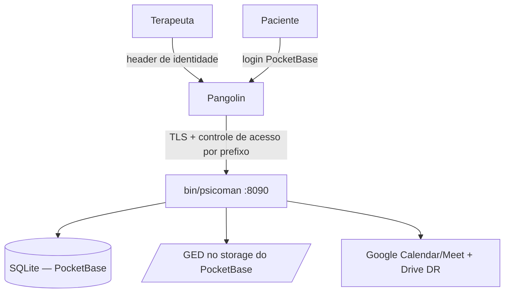

# Psicoman — Guia de Instalação e Deploy

Guia para colocar uma instância do Psicoman no ar. Cada terapeuta roda **uma
instância isolada** (uma VM por terapeuta): **um único binário** (`bin/psicoman`,
com o PocketBase embarcado) atrás do gateway **Pangolin**.

> Arquitetura vigente (onda `pocketbase-core` + `pocketbase-finish`): processo
> único, segregação por ator **lógica** (`/v1/app`, `/v1/portal`, `/v1/admin`),
> cifra por campo (AES-256-GCM), Google via OAuth 3-legged (`calendar` +
> `drive.file`, **sem Gmail**). Ver [`architecture.md`](./architecture.md) e
> [`requirements.md`](./requirements.md).

---

## Visão geral do que você vai montar



- O binário escuta **apenas em loopback** (`127.0.0.1:8090`). Quem expõe para a
  internet, com TLS, é o Pangolin.
- O Pangolin injeta o **header de identidade** do terapeuta em `/v1/app/*` e
  `/v1/admin/*`; `/v1/portal/*` usa a sessão real do PocketBase (login do
  paciente) + o gate de aprovação da aplicação.

---

## 1. Pré-requisitos

| Ferramenta | Uso | Como checar |
|-----------|-----|-------------|
| Go 1.27+  | compilar o binário | `go version` |
| git       | clonar/atualizar o código | `git --version` |
| openssl   | gerar a chave de cifra | `openssl version` |
| curl      | validação de saúde | `curl --version` |
| systemd   | rodar como serviço | `systemctl --version` |

Uma conta **Google pessoal** (Google One serve) do terapeuta — sem necessidade
de Google Workspace nem domain-wide delegation.

---

## 2. Provisão da VM

Qualquer Linux recente com systemd serve (2 vCPU / 2 GB RAM / 20 GB disco é
confortável para um consultório).

```bash
sudo apt update && sudo apt -y upgrade
sudo apt -y install git curl openssl
# Go 1.27+: baixe de https://go.dev/dl/ e ajuste o PATH, se o repo não tiver.

git clone https://github.com/rafaelfino/psicoman.git
cd psicoman
```

Mantenha o relógio da VM sincronizado (NTP). O sistema opera internamente em
`America/Sao_Paulo`.

---

## 3. Compilar e configurar

### 3.1 Compilar o binário único

```bash
make build        # gera bin/psicoman (go build -o bin/psicoman ./cmd/psicoman)
```

### 3.2 Gerar o `config.yaml`

Copie o exemplo e preencha. **Nunca** versione o `config.yaml` com segredos.

```bash
cp config.example.yaml config.yaml
openssl rand -base64 32    # gere a chave de cifra (32 bytes) e cole em crypto.keys.k1
```

Campos (ver [`../config.example.yaml`](../config.example.yaml)):

- `crypto.key_id` / `crypto.keys` — **obrigatório** (fail-closed: sem cifra o
  boot aborta). `key_id` aponta a chave corrente; `keys` é um mapa `id -> base64`
  (chaves antigas ficam para decifrar o que foi gravado antes de uma rotação).
- `pangolin.identity_header` — nome do header de identidade (default
  `X-Pangolin-User`). Não é segredo.
- `google.*` — `client_id`/`client_secret`/`calendar_id`/`drive_folder`. Vazios ⇒
  Calendar/Drive degradam (no-op, sem evento/espelho), sem derrubar o processo.
- `llm.gemini.api_key` — opt-in da IA pela **presença** da chave. Vazio ⇒ IA off.

> Alternativa a arquivo: toda chave tem env equivalente e **env sobrescreve o
> arquivo** (ex.: `PSICOMAN_CIPHER_KEY_ID`, `PSICOMAN_CIPHER_KEYS`,
> `PSICOMAN_PANGOLIN_IDENTITY_HEADER`, `PSICOMAN_GEMINI_API_KEY`). A origem de
> cada chave (arquivo|env|default) é **logada no boot sem vazar o valor**.

---

## 4. Credenciais do Google (OAuth 3-legged)

O Psicoman usa **OAuth 3-legged** com refresh token (conta pessoal). Você cria um
projeto no Google Cloud, habilita as APIs e gera um **Client ID + Client Secret**.

### 4.1 Projeto + APIs

1. <https://console.cloud.google.com/> → novo projeto (ex.: `psicoman-<seu-nome>`).
2. **APIs e Serviços → Biblioteca**, habilite:
   - **Google Calendar API**
   - **Google Drive API**
   (Gmail **não** é usado — a cobrança é PDF no GED, enviada pela terapeuta fora da plataforma.)

### 4.2 Tela de consentimento

1. **APIs e Serviços → Tela de permissão OAuth** → tipo **Externo**.
2. Em **Escopos**, adicione exatamente os mínimos:
   - `https://www.googleapis.com/auth/calendar`
   - `https://www.googleapis.com/auth/drive.file`
3. Em **Usuários de teste**, adicione o e-mail do terapeuta. Em modo de teste, só
   esses e-mails autorizam — suficiente para uma instância pessoal.

> Referência oficial: [Configurar a tela de consentimento OAuth](https://developers.google.com/workspace/guides/configure-oauth-consent). _Conteúdo adaptado das docs do Google._

### 4.3 Credenciais OAuth

1. **Credenciais → Criar credenciais → ID do cliente OAuth** → **Aplicativo da Web**.
2. Em **URIs de redirecionamento autorizados**, adicione a URL de callback (a
   mesma do domínio público), por exemplo:

   ```
   https://psicoman.seudominio.com.br/v1/admin/google/callback
   ```

3. Copie o **Client ID** e o **Client Secret** para `google.client_id` /
   `google.client_secret` do `config.yaml`. **Nunca** versione.

### 4.4 Autorizar (depois de subir — passo 6)

A autorização é uma vez só, pelo navegador do operador (o fluxo redireciona ao
consentimento do Google e volta no callback):

1. Acesse, autenticado pelo Pangolin, a rota de autorização:
   `https://psicoman.seudominio.com.br/v1/admin/google/authorize`
   — ela redireciona ao consentimento do Google (`access_type=offline`,
   `prompt=consent`, escopos `calendar`+`drive.file`).
2. Conceda o acesso. O Google chama de volta
   `/v1/admin/google/callback?code=...`, o Psicoman troca o code pelo **refresh
   token** e o persiste **cifrado** na coleção `google_token`.
3. Confira o estado:
   `curl https://psicoman.seudominio.com.br/v1/admin/google/status`
   → `{"state":"ok"}` quando autorizado; `degraded` se pendente.

A partir daí o access token é renovado automaticamente. Se a renovação falhar no
futuro, `/v1/readyz` passa a reportar `google: degraded` (reautorização
necessária) — basta repetir este passo. O refresh token nunca aparece em resposta
nem em log.

---

## 5. Pangolin (borda)

O Pangolin termina o TLS e aplica o controle de acesso por **prefixo de rota**:

- `/v1/app/*` e `/v1/admin/*` → Pangolin injeta o **header de identidade** do
  terapeuta (o mesmo `pangolin.identity_header` do config; default
  `X-Pangolin-User`). Ausente/vazio ⇒ a aplicação responde **401**.
- `/v1/portal/*` → Pangolin **só termina TLS**. A autenticação é do PocketBase
  (login do paciente, `auth-with-password` da coleção `patient_user`) + o gate de
  aprovação da aplicação.

Configuração (nomes variam conforme a versão do Pangolin):

1. **Upstream**: `http://127.0.0.1:8090` (onde o binário escuta).
2. **Domínio público**: `psicoman.seudominio.com.br` (TLS gerenciado pelo Pangolin).
3. **Identidade**: configure o provedor de identidade do Pangolin para injetar o
   header de e-mail do terapeuta nos prefixos `/v1/app` e `/v1/admin`.
4. **DNS**: aponte o domínio para o Pangolin.

> Como o binário escuta só em loopback, ele **não** fica acessível direto da
> internet. Todo o tráfego externo passa pelo Pangolin.

Proteções de borda recomendadas no Pangolin para o portal: limite de requisições
por IP em `/v1/portal/register`, limite de tamanho de corpo e timeouts curtos.

---

## 6. Rodar como serviço (systemd)

Um **único** serviço. Crie um usuário de serviço e a unit:

```bash
sudo useradd --system --home /opt/psicoman --shell /usr/sbin/nologin psicoman || true
sudo mkdir -p /opt/psicoman /var/lib/psicoman
sudo cp bin/psicoman /opt/psicoman/psicoman
sudo cp config.yaml /opt/psicoman/config.yaml
sudo chown -R psicoman:psicoman /opt/psicoman /var/lib/psicoman
sudo chmod 600 /opt/psicoman/config.yaml
```

`/etc/systemd/system/psicoman.service`:

```ini
[Unit]
Description=Psicoman (binário único, PocketBase embarcado)
After=network-online.target
Wants=network-online.target

[Service]
User=psicoman
Group=psicoman
WorkingDirectory=/opt/psicoman
# A config de cifra pode vir do config.yaml (--config) ou de env (fail-closed).
ExecStart=/opt/psicoman/psicoman serve --http 127.0.0.1:8090 --dir /var/lib/psicoman --config /opt/psicoman/config.yaml
Restart=on-failure
RestartSec=3
# Endurecimento básico:
NoNewPrivileges=true
ProtectSystem=strict
ReadWritePaths=/var/lib/psicoman
ProtectHome=true

[Install]
WantedBy=multi-user.target
```

```bash
sudo systemctl daemon-reload
sudo systemctl enable --now psicoman
```

As **migrations do MER são aplicadas automaticamente no boot** (o PocketBase roda
`RunAllMigrations`). A admin UI nativa fica em `/_/` (crie o superusuário com
`psicoman superuser upsert <email> <senha> --dir /var/lib/psicoman`).

### Verificação rápida

```bash
# Na VM (loopback):
curl -s http://127.0.0.1:8090/v1/livez    # {"data":{"status":"alive"}}
curl -s http://127.0.0.1:8090/v1/readyz   # ready:true (google degraded até autorizar)

# Pelo domínio (após o Pangolin):
curl -s https://psicoman.seudominio.com.br/v1/livez
```

Swagger: `https://psicoman.seudominio.com.br/v1/swagger`.

### Primeiro uso (jornada ponta a ponta)

1. Autorize o Google (passo 4.4).
2. Configure o perfil do terapeuta (aparece no cabeçalho da cobrança):

   ```bash
   curl -X PUT https://psicoman.seudominio.com.br/v1/app/therapist \
     -H 'X-Pangolin-User: terapeuta@seudominio.com.br' -H 'Content-Type: application/json' \
     -d '{"name":"Dra. Fulana","crp":"06/12345","email":"terapeuta@seudominio.com.br"}'
   ```

3. Cadastre uma **origem**, um **local**, um **paciente** e um **plano** (por
   consulta), agende uma **sessão**, finalize-a (o débito é gerado
   automaticamente pelo plano vigente) e gere a **cobrança** em PDF:

   ```bash
   H='-H X-Pangolin-User:terapeuta@seudominio.com.br -H Content-Type:application/json'
   base=https://psicoman.seudominio.com.br/v1/app
   # paciente
   pid=$(curl -s $H -X POST $base/patients -d '{"name":"Ana","phone":"11999990000","email":"ana@x.com"}' | jq -r .data.id)
   # plano por consulta
   curl -s $H -X POST $base/patients/$pid/plans -d '{"type":"pagamento_por_consulta","amount_cents":18000,"starts_at":"2026-01-01T00:00:00-03:00"}'
   # sessão + finalizar
   sid=$(curl -s $H -X POST $base/sessions -d '{"patient_id":"'$pid'","modality":"online","starts_at":"2026-06-10T14:00:00-03:00","ends_at":"2026-06-10T15:00:00-03:00"}' | jq -r .data.id)
   curl -s $H -X POST $base/sessions/$sid/finish -d '{"bill":true}'
   # débito gerado → cobrança
   did=$(curl -s $H $base/patients/$pid/debts | jq -r '.data[0].id')
   curl -s $H -X POST $base/debts/$did/invoice
   ```

---

## 7. Atualizar com segurança

Atualização manual, com backup antes e validação depois:

```bash
# 1. Backup do data dir (SQLite + storage) a quente via a rota de backup do PocketBase:
curl -s -X POST https://psicoman.seudominio.com.br/v1/admin/backup \
  -H 'X-Pangolin-User: terapeuta@seudominio.com.br'
#    (ou copie /var/lib/psicoman com o serviço parado).

# 2. Nova versão + recompila. Se a compilação falhar, NÃO toque em produção.
cd /caminho/para/psicoman && git fetch && git checkout <tag>
make build

# 3. Troca o binário e reinicia (migrations aplicam no boot).
sudo systemctl stop psicoman
sudo cp bin/psicoman /opt/psicoman/psicoman
sudo systemctl start psicoman

# 4. Valida. Se /readyz não ficar pronto, restaure o binário anterior e o backup.
curl -s http://127.0.0.1:8090/v1/readyz
```

A **chave de cifra** vive apenas no `config.yaml` (ou no env). Guarde uma cópia
segura **fora da VM** — sem ela, nem os dados nem os backups cifrados são
recuperáveis.

> Os scripts `scripts/deploy.sh` e `scripts/update-server.sh` são do modelo
> antigo (dois binários) e **não** se aplicam à arquitetura atual; use os passos
> manuais acima.

---

## 8. Operação do dia a dia

```bash
sudo systemctl status psicoman
sudo journalctl -u psicoman -f
sudo systemctl restart psicoman
```

Observabilidade (fora da auth, para probes):

- `/v1/livez` — o processo está vivo (200 fixo).
- `/v1/readyz` — cifra montada + DB acessível + estado do OAuth Google
  (`google: ok|degraded`). 503 se cifra ou DB falham.
- `/v1/health` — smoke simples no envelope.

O timing por rota é logado (não há endpoint de métricas dedicado nesta versão —
decisão registrada em [`decisions.md`](./decisions.md)).

---

## 9. Solução de problemas

| Sintoma | Provável causa | O que fazer |
|--------|----------------|-------------|
| Boot aborta na partida | cifra ausente/inválida (fail-closed) | Defina `crypto.key_id`+`crypto.keys` no config ou `PSICOMAN_CIPHER_*` |
| `/v1/readyz` com `google: degraded` | refresh token do Google ausente/expirado | Autorize/reautorize (passo 4.4) |
| `/v1/app/*` responde `401` sempre | header de identidade do Pangolin não chega | Confira o `identity_header` e a injeção no Pangolin |
| Portal responde `401` em `/v1/portal/*` | sessão ausente/expirada | Faça login de novo (auth-with-password) |
| Sessão não vira evento no Calendar | Google não autorizado ou `calendar_id` vazio | Autorize o Google e preencha `google.calendar_id` |

---

## 10. Checklist final

- [ ] VM provisionada, Go 1.27+, relógio sincronizado.
- [ ] `config.yaml` com a chave de cifra (nunca versionada) — cópia da chave num cofre fora da VM.
- [ ] Projeto Google: Calendar + Drive habilitados; consentimento com escopos mínimos; Client ID/Secret no config; redirect `/v1/admin/google/callback` cadastrado.
- [ ] Pangolin: upstream `127.0.0.1:8090`, identidade injetada em `/v1/app` e `/v1/admin`, DNS apontado.
- [ ] `systemctl enable --now psicoman`; `/v1/readyz` pronto.
- [ ] Google autorizado (`/v1/admin/google/status` = ok); perfil do terapeuta configurado.
- [ ] Jornada de ponta a ponta: origem → local → paciente → plano → sessão → finalizar → débito → cobrança.
