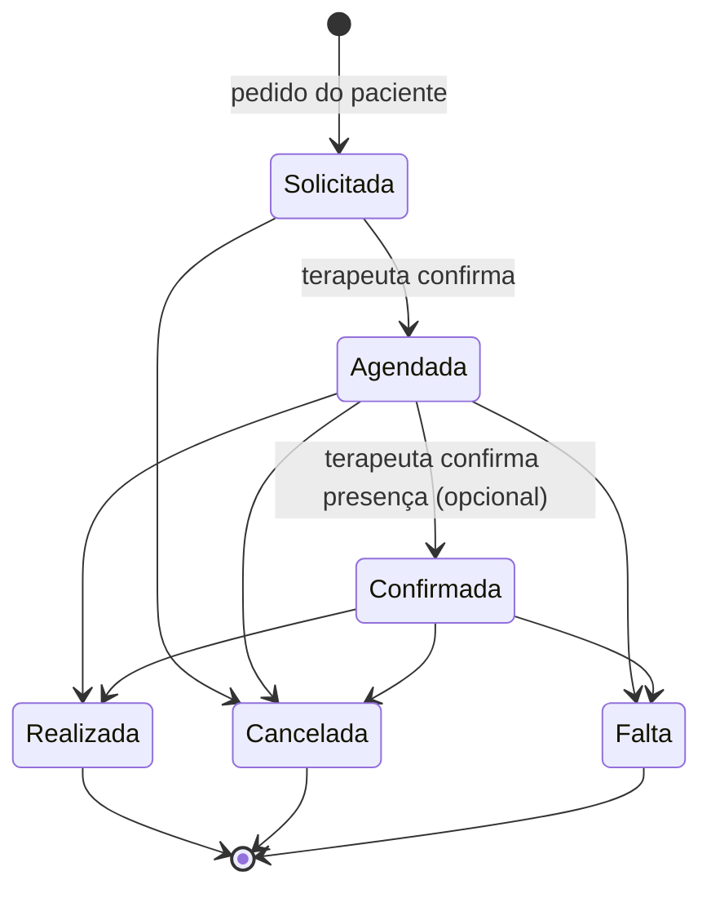

# Psicoman — Requisitos

Especificação de requisitos da plataforma de gestão de atendimentos para psicologia. Escopo aqui descrito = **MVP**.

> Este documento responde **o quê** e **por quê**. O **como** está em [`architecture.md`](./architecture.md); o **plano de implementação** da onda atual em [`.kiro/specs/pocketbase-core/`](../.kiro/specs/pocketbase-core/); a **visão geral** em [`../README.md`](../README.md).

---

## 1. Visão Geral

Plataforma para um terapeuta gerenciar pacientes, agenda, sessões, prontuário, financeiro e custos, com um portal self-service para o paciente agendar e acompanhar seus atendimentos. **Single-tenant:** uma instância isolada por terapeuta (uma VM por terapeuta).

- **Um único binário Go** com o **PocketBase embarcado como framework**: SQLite relacional (WAL), servidor HTTP, file storage, auth/OAuth2, migrations e a admin UI nativa (`/_/`) vêm de dentro dele. As rotas próprias `/v1/*` são registradas no hook `app.OnServe()`.
- Roda **sempre atrás do gateway Pangolin**, que termina TLS e injeta a identidade do terapeuta na borda; nunca exposto direto à internet.
- Integração com Google **Calendar/Meet** (agenda, síncrono) e **Drive** (fallback/DR do backup). **Gmail está fora de escopo** — a cobrança é um PDF no GED, enviado pela terapeuta por fora (WhatsApp).
- Assistência opcional por **IA (Gemini)**: resumo clínico + tags, opt-in e revisável.

---

## 2. Atores e Acesso

A segregação é **lógica, por prefixo de rota** (um binário, três superfícies), desenhada para o Pangolin aplicar controle de acesso por path:

| Path | Ator | Pangolin | Autenticação | Escopo |
|------|------|----------|--------------|--------|
| `/v1/app/*` | Terapeuta (também a operadora, no single-tenant) | Com controle de acesso | Header de identidade injetado pelo Pangolin (401 se ausente) + defesa em profundidade no servidor | Acesso total |
| `/v1/portal/*` | Paciente | Só TLS, aberto | Sessão própria do paciente (coleção de auth do PocketBase) + **gate de aprovação** | Mínimo: próprio perfil/estado, suas sessões |
| `/v1/admin/*` | Operação técnica | Com controle de acesso (o mais restrito) | Header do Pangolin | Backup, auditoria |
| `/_/` (admin UI nativa) | Operação técnica | Mesma política de `/v1/admin/*` | Pangolin na borda + login de superuser do PocketBase | Dashboard/schema/debug |

Requisitos:
- O acesso do paciente **nunca** alcança dado clínico nem função administrativa — a segregação é por path + middleware, e nenhuma resposta do portal inclui campo clínico.
- Tudo atrás do Pangolin (TLS). No portal o Pangolin só termina TLS; a autenticação do paciente é da própria aplicação (sessão do PocketBase).
- O paciente só enxerga dados vinculados à sua sessão autenticada.
- O acesso administrativo não pode depender apenas do gateway (defesa em profundidade): o servidor revalida a identidade.

> Realização técnica (binário único, contrato `/v1` por ator, middleware, sessão): `architecture.md §0`.

---

## 3. Requisitos Funcionais

### 3.1 Cadastro de Pacientes

- Obrigatórios: **nome, telefone, email**.
- **CPF opcional** — sem CPF **não é possível emitir recibo nem Receita Saúde** (a operação é bloqueada com mensagem em PT-BR).
- O **telefone é normalizado na entrada** (admin e portal) para forma canônica: só dígitos, com DDI do Brasil (`55`) quando ausente. Números implausíveis (sem DDD/número) são rejeitados com mensagem em PT-BR. No admin, o telefone é exibido como **link para o WhatsApp** (`wa.me`), abrindo a conversa em nova aba (onda `prontuario-ux`).
- Cada paciente tem **ID único (ULID)** referenciado em todo o sistema.
- Cada paciente tem uma **origem** (canal de aquisição: Doctoralia, indicação, etc.), base para o cálculo de ROI.
- Cadastro pode ser iniciado pelo terapeuta (completo) ou pelo próprio paciente no portal (dados básicos); o terapeuta complementa os dados clínicos.
- **Email é único** por paciente. **CPF, quando informado, também é único.**
- Se o paciente se cadastra no portal com um email que já corresponde a um paciente existente (cadastrado pelo terapeuta), o sistema **vincula ao registro existente** em vez de criar um duplicado.

#### 3.1.1 Aprovação de acesso ao portal (gate)

Como o portal fica exposto na internet e o Pangolin não aplica controle de acesso (§4.1), todo paciente tem um **estado de aprovação**: `pendente`, `aprovado` ou `rejeitado`.

- Auto-cadastro pelo portal nasce **`pendente`**; cadastro feito pelo terapeuta nasce **`aprovado`** (o terapeuta é a autoridade de aprovação).
- Vínculo por email não rebaixa: se o email já é de um paciente `aprovado`, o auto-cadastro mantém `aprovado`.
- Enquanto `pendente`/`rejeitado`, o paciente **não acessa nenhum recurso** do portal (agenda, pedidos, sessões, débitos, edição de perfil). Só pode consultar o próprio estado e sair. O bloqueio é imposto **no servidor** (HTTP 403), não só na UI.
- O terapeuta tem uma **fila de aprovação** no admin (com contagem destacada) para aprovar/rejeitar; aprovar/rejeitar registram **audit log**. Aprovar libera o acesso imediatamente.
- Persistido por migration aditiva (registros pré-existentes → `aprovado`, idempotente).

### 3.2 Locais de Atendimento

- Cada local tem nome, endereço, modalidade (presencial ou online) e **custo** com periodicidade (`por_sessao`, `diario`, `mensal`, `anual`).
- Cada local tem **disponibilidade de agenda** (janelas de atendimento), base para as lacunas ofertadas ao paciente.

### 3.3 Agenda e Sessões

- O **Google Calendar** é consultado e escrito de forma **síncrona** (é o único Google no caminho de request). Antes de confirmar uma sessão (agendamento direto pelo terapeuta ou confirmação de um pedido do paciente), o sistema **consulta o `freebusy`** do terapeuta para verificar conflito de horário com outros compromissos (incluindo eventos não criados pelo Psicoman). Havendo conflito, a confirmação é bloqueada (**HTTP 409**) com mensagem PT-BR.
- Ao efetivar uma sessão, o evento inclui o **paciente como convidado** e, quando a sessão é **online**, um link do **Google Meet** (sessão presencial não cria Meet).
- Sem credenciais do Google configuradas, o Calendar **degrada graciosamente**: a sessão é agendada sem evento (no-op, sem derrubar a operação), com aviso no log.
- **Notificações ao paciente são delegadas ao Google Calendar** (reminders do evento). Default: 1 dia antes + 30 min antes, acumulativos; os intervalos são configuráveis. O sistema não implementa canal de notificação próprio.
- **Fluxo de solicitação pelo paciente:** o paciente vê lacunas abertas e cria um **pedido de agendamento** (registro interno, nada toca o Google). O terapeuta vê os pedidos numa tela de pendências e, ao **confirmar**, o sistema cria o evento + Meet e efetiva a sessão.

**Ciclo de vida da sessão:**

- A sessão suporta um estado explícito e **opcional** de `confirmada` (entre `agendada` e os desfechos), com `confirmed_at` registrado (onda `patient-timeline` R6.1). Uma sessão agendada ainda pode ir direto a realizada/falta/cancelada.
- O **cancelamento** registra metadados (onda `patient-timeline` R6.2): `canceled_by` (`paciente`|`terapeuta`, **obrigatório**), `cancel_reason` (texto livre, opcional) e `canceled_at`. O status permanece único (`cancelada`); autor e motivo são metadados. A operação é auditada (sem conteúdo clínico em metadata).
- Ao mudar o estado (Realizada / Cancelada / Falta), o terapeuta decide dois flags independentes:
  - **Haverá cobrança?** → gera ou não débito financeiro. Desde a onda `patient-timeline` (R1.3), a cobrança é o **padrão** de uma sessão realizada de plano por-sessão: o flag funciona como **opt-out explícito** ("esta sessão não gera cobrança"). Não é mais preciso lembrar de marcá-lo para gerar o débito.
  - **Custos serão considerados?** → a sessão computa ou não custo de local/infra.
- **Edição de sessão** (onda `prontuario-ux`): o terapeuta pode abrir uma sessão (na Agenda ou no Prontuário) e editar **data/hora, local e modalidade** (`PUT /v1/app/sessions/{id}`). A edição **não troca o paciente** e é **bloqueada em estados terminais** (realizada/cancelada/falta); o registro clínico da sessão continua permitido. A edição é auditada. Quando a sessão tem evento no Google, a UI avisa para ajustar o convite manualmente (a reconciliação automática com o Calendar está fora de escopo desta onda — ver [`decisions.md`](./decisions.md)).
- **Visão semanal fluida** (onda `prontuario-ux`): a agenda semanal (seg–sáb, sem domingo) acomoda muitos atendimentos no mesmo dia; a coluna do dia **cresce conforme a lotação** (referência ~10/dia), sem deformar os dias vizinhos. Cada cartão é clicável e abre o painel da sessão.
- **Feed do dia do terapeuta** (onda `patient-timeline` R8): a **visão inicial** do admin é um feed transversal a todos os pacientes, com cards didáticos do que aconteceu (sessões, pagamentos, débitos, arquivos) e do que vem (próximas sessões, vencimentos, pedidos pendentes), agrupados por faixa temporal e com janela ajustável (hoje/próximos 7 dias/recentes). O bloco de **resumo agregado** nasce colapsado; os eventos individuais ficam visíveis. A agenda em grade continua acessível pelo menu. Servido por `GET /v1/app/day-feed`.

### 3.4 Planos e Pagamentos

Planos/acordos por paciente:

| Plano | Descrição |
|-------|-----------|
| `pagamento_por_consulta` | Pago por sessão realizada |
| `pagamento_por_mes` | Pós-pago: soma das sessões realizadas no mês (variável) |
| `plano_fechado_mensal` | Valor fixo mensal, independente do nº de sessões |
| `plano_fechado_trimestral` | Valor fixo trimestral |
| `atendimento_social` | Sem pagamento fixo |

- Planos fechados têm um **dia de vencimento** (`due_day`, 1–28), que ancora a cobrança do ciclo.
- O **gatilho de geração do débito depende do tipo de plano**:
  - `pagamento_por_consulta` / `pagamento_por_mes`: **por sessão** — ao marcar a sessão como realizada, o sistema gera a **entrada de valor a receber (débito)** automaticamente (padrão), de forma **idempotente** (uma sessão não gera dois débitos). O terapeuta pode suprimir via opt-out (`bill=false`). Sem plano vigente, não gera e registra a condição de forma observável (audit `debt_skip_no_plan`).
  - `plano_fechado_mensal` / `plano_fechado_trimestral`: **por ciclo de cobrança** — o débito do valor fixo é gerado automaticamente **a partir do dia de vencimento** do período vigente do plano, **independente do número de sessões realizadas**. O `due_date` do débito é a data real do vencimento. A geração é idempotente (um período não gera dois débitos para o mesmo plano), mesmo com o cron rodando diariamente após o vencimento. No trimestral, o vencimento é ancorado no 1º mês do trimestre.
  - `atendimento_social`: **nunca gera débito**, independente de qualquer flag marcado na sessão.
- Ao encerrar uma sessão faturável, o terapeuta informa a forma de pagamento conforme o plano do paciente (ou cadastra uma nova).
- O sistema gera um **PDF de cobrança**, armazenado no GED como lastro (file storage do PocketBase, dedup por SHA-256). **Não há envio por email** (Gmail fora de escopo): o terapeuta baixa/compartilha o PDF por fora (WhatsApp).
- O terapeuta pode **registrar o pagamento** quitando um débito e **anexar comprovantes** (que vão para o GED).
- **Recibos / Receita Saúde exigem CPF** do paciente.
- **Relatórios financeiros** (gerais ou por paciente): débitos gerados, débitos em aberto, valores recebidos, considerando atrasos.

### 3.5 Custos e ROI

Cadastro de custos: **local** (§3.2), **CRP** (anual), **infraestrutura** (Google, etc.), **plataformas** de aquisição (Doctoralia, etc.) com custo por período.

- **Custo por sessão / por paciente:** custo `por_sessao` é atribuído direto; custos `diario`/`mensal`/`anual` são **rateados proporcionalmente** entre as sessões realizadas no local no período. Objetivo: comparar o custo real de sessão online vs. presencial e subsidiar a precificação de cada paciente. A sessão só computa custo se o flag "considerar custos" estiver marcado.
- **ROI por canal de origem:** cruza a **receita gerada pelos pacientes de cada origem** com o **custo da plataforma correspondente** no período, respondendo se o investimento no canal tem retorno.
- **Relatórios de custo:** totais com visão anual, mensal ou por paciente.
- **Relatório de sessões por local** (onda `patient-timeline` R7): para um local e um período (default: mês atual), agrega as sessões por categoria (as mesmas das métricas do paciente) e o **faturado das sessões realizadas** no período (soma dos débitos vinculados, em centavos). Agrupa por `starts_at` no fuso `America/Sao_Paulo`; serve de repasse para clínicas parceiras. Servido por `GET /v1/app/locations/{id}/session-report`. Exportação CSV/impressão fica como melhoria futura.

### 3.6 Prontuário e Gestão de Atendimentos

- **Anamnese** e **controle terapêutico** por paciente.
- **Notas de sessão**: texto + anexos, vinculadas a uma sessão específica.
- **Notas livres**: sem vínculo com sessão (lembretes). Notas de sessão e livres sempre ordenadas por **data de criação**.
- **GED segregado por paciente**, isolando documentos.
- **Templates em Markdown** para enviar ao paciente (ex: anamnese); o envio usa sempre a versão **formatada**.
- **Prontuário unificado** (onda `prontuario-ux`; feed reforçado em `patient-timeline` R3): no detalhe do paciente, uma aba única **Prontuário** reúne, numa **linha do tempo por data do mais recente ao mais antigo**, as **sessões** com seus **registros clínicos vinculados** e as **notas livres**. Substitui as abas antigas "Sessões" e "Notas". A **Anamnese** aparece como **ficha inicial** destacada no topo do feed e como **marco fundacional** no fim da linha do tempo (início da história clínica), além de editável à parte. O topo traz uma composição rápida ("Registrar o que aconteceu…") e um resumo (total de sessões, realizadas, faltas, último registro). O ato de **agendar** continua na Agenda; o Prontuário trata do **registro clínico**. Ao abrir uma sessão no Prontuário, é possível editá-la (§3.3) e adicionar/remover registros vinculados.
- **Timeline unificada do paciente** (onda `patient-timeline` R4): a história completa do paciente é um **feed cronológico** (mais recente no topo) que agrega cadastro/aprovação, sessões, **remarcações**, registros clínicos e notas livres, anamnese, débitos, pagamentos e arquivos. É **composta no servidor** (`GET /v1/app/patients/{id}/history`), derivada das fontes existentes (sem tabela de eventos). Cada evento tem data, tipo, resumo legível e referência à entidade de origem (para abrir sessão/débito/arquivo). A **remarcação** de horário de uma sessão agendada/confirmada é registrada de forma rastreável no audit log (`session.reschedule`, de/para, sem conteúdo clínico). A leitura do histórico respeita a auditoria de leitura clínica (`AuditActionRead`), sem expor conteúdo clínico em metadados.
- **Calendário mensal do paciente** (onda `patient-timeline` R2): no detalhe do paciente, uma visão de calendário mensal mostra todas as sessões daquele paciente — passadas (realizadas, faltas, canceladas) e futuras (agendadas, confirmadas, solicitadas) —, com cor por status, contagem quando há mais de uma no dia e navegação por mês (anterior/próximo/hoje). Reusa `GET /v1/app/sessions?patient_id=&from=&to=`; o agrupamento por dia respeita o fuso `America/Sao_Paulo`. Clicar num dia/sessão abre o registro da sessão.
- **Métricas de sessão do paciente** (onda `patient-timeline` R6.4–R6.5): a tela do paciente exibe um bloco de métricas com a quebra por categoria (realizadas, faltas, canceladas pelo paciente, canceladas pelo terapeuta, agendadas/confirmadas, solicitadas) e as taxas de **comparecimento** e **cancelamento**, agrupando por `starts_at` (fuso `America/Sao_Paulo`), por padrão sobre o histórico completo (com recorte opcional por período). Servido por `GET /v1/app/patients/{id}/session-metrics`.

#### 3.6.1 Assistência por IA (resumo + tags, opt-in)

Assistência opcional da IA (Gemini) ao registro clínico, respeitando a privacidade do paciente:

- **Opt-in por instância, default desligado:** a IA só funciona quando a chave `llm.gemini.api_key` está configurada. Sem chave, nenhuma chamada é feita e o disparo responde erro de validação.
- **Disparo explícito** pelo terapeuta (nunca automático em cima do prontuário) e **resultado revisável**: o resumo nasce `sugerido`; o terapeuta revisa (resumo e tags) e **consolida** — só então as tags entram no índice.
- **Minimização:** à IA vai apenas o texto clínico a resumir, sem identificadores do paciente. A operação é auditada (`ai.process`) **sem** conteúdo clínico (só o fato do processamento).
- **Índice de busca por tags:** as tags geradas ficam **em claro** (indexáveis) por paciente/ano, enquanto o corpo clínico permanece cifrado (`SealedText`). A busca por tag é **isolada por paciente** — nunca cruza pacientes.
- **Base legal:** os dados são da própria terapeuta (controladora), que já faz esse trabalho manualmente; a IA assiste.

### 3.7 Integração Google

- Integrar com **Calendar/Meet** (agenda e sessões, síncrono — §3.3) e **Drive** (fallback/DR do backup — §3.8). **Gmail está fora de escopo.**
- Autorização única pelo terapeuta (OAuth 3-legged, conta pessoal), com renovação automática do acesso sem reautorização recorrente.
- **Escopos mínimos**, nunca mais amplos que o necessário: `calendar` (Calendar/Meet) e `drive.file` (só arquivos criados pela app).

> Realização técnica (OAuth 3-legged, escopos, refresh token cifrado): `architecture.md §0.9, §0.10`.

### 3.8 Backup e Restore

- **Backup** da base pelo mecanismo nativo do PocketBase (`CreateBackup`), disparável pela operação (`POST /v1/admin/backup`).
- **Fallback/DR no Google Drive:** um hook no ciclo de backup envia o snapshot **cifrado** (AES-256-GCM) a uma pasta fria no Drive. O Drive **não** é fonte da verdade nem está no caminho de request; é só espelho de recuperação de desastre. Sem credenciais do Google, o backup local segue (o espelho é best-effort).
- O file storage do PocketBase (GED) é parte do `pb_data` coberto pelo backup.

> Realização técnica (hook `OnBackupCreate`, cifra de blob, `drive.file`): `architecture.md §0.10`.

### 3.9 Perfil do Terapeuta

O terapeuta tem uma tela para inserir e editar seus próprios dados. Como cada instância atende um único terapeuta, há **um** perfil por instância.

- Dados: **nome**, **CRP** (número de registro profissional), **email**, **contatos** (telefone e outros), **foto**, **bio** (texto).
- **Locais de atendimento** associados ao terapeuta — associação com a entidade Local (§3.2), não um novo cadastro de endereço.
- **Links de plataformas** de perfil/conteúdo (Doctoralia, Zenklub, Terapy, etc.): rótulo + URL. Quando a plataforma também for uma origem de aquisição/custo (§3.5), o link pode referenciar essa origem, evitando cadastro duplicado.
- A foto e demais arquivos do perfil ficam no GED (área do próprio terapeuta, separada das pastas de pacientes).
- Dados públicos do perfil (nome, foto, bio) podem ser exibidos no portal do paciente; CRP, contatos e email seguem a política de exibição definida na UI (não são dados sensíveis de saúde, mas o telefone/email do terapeuta só aparecem onde fizer sentido).

> Realização técnica (entidade `therapist_profile`, relação com `location` e `origin`): `architecture.md §3.2`.

---

## 4. Requisitos Não-Funcionais

### 4.1 Segurança e Conformidade

- Infra segregada e permissionada por instância (uma VM por terapeuta), acesso por chaves seguras.
- Prontuário é dado sensível de saúde: **cifra por campo em repouso** (`SealedText`, AES-256-GCM), **audit log** de operações sensíveis (prontuário, débitos, config, backup, IA) sem conteúdo clínico, snapshot de backup cifrado.
- **Não-vazamento clínico:** nenhuma resposta serializa o campo clínico direto; o claro só sai pelo DTO do ator terapeuta (`Reveal()`). Nem o superuser vê clínico em claro pela REST nativa do PocketBase (envelope cifrado em repouso). O portal **nunca** recebe campo clínico.
- **Todo tráfego externo é HTTPS**, com TLS terminado no Pangolin. `/v1/app/*` e `/v1/admin/*` ficam **com** controle de acesso (identidade no header do Pangolin); `/v1/portal/*` fica **sem** controle de acesso no gateway — a autenticação do paciente é da própria aplicação (sessão do PocketBase) + gate de aprovação imposto no servidor.
- Toda regra sensível é imposta no servidor (defesa em profundidade), mesmo com o Pangolin na frente; a UI só reflete.

### 4.2 Padrões de Domínio

- **ULID** em todas as entidades.
- **BRL** como única moeda; valores em centavos (inteiro).
- Fuso fixo **`America/Sao_Paulo`**.
- **Idempotência** na geração de débito.
- **GED com hash SHA-256** (integridade e deduplicação).

### 4.3 Observabilidade e Operação

- **Logs** com níveis (debug/warn/info/error) e **rotação diária**.
- **Métricas** e endpoints de **healthcheck, readiness, liveness**.
- **Config por arquivo YAML** (`config.yaml`), com **env sobrescrevendo** o arquivo e a origem de cada chave logada no boot (sem vazar segredo), para deploy seguro e segregação de ambientes.
- **Makefile** capaz de gerar o binário único (`make build` → `bin/psicoman`).
- **Testes E2E** cobrindo a solução sobre o binário único (Google/Gemini mockados), garantindo não-regressão.

### 4.4 API

- Toda resposta `/v1/*` traz o envelope **`{ message, elapsed_ms, data, error }`** com **mensagem em PT-BR** e **tempo de processamento em ms**, com código HTTP coerente.
- Rotas **versionadas** (`/v1`) e **segregadas por ator** (`/v1/app`, `/v1/portal`, `/v1/admin`). A REST automática do PocketBase **não** é o contrato público (coleções trancadas).
- **Swagger** documentado em `GET /v1/swagger` (e `/v1/swagger.json`).

> Contrato detalhado (envelope, rotas por ator, DTOs): `architecture.md §0.6`.

### 4.5 Interface (UX)

- Moderna, limpa, leve, acolhedora e empática. Usuários com pouco conhecimento técnico: zero jargão, fluxos curtos, feedback claro em PT-BR.
- Paleta suave, tipografia legível, espaçamento generoso, ícones simples, **acessibilidade WCAG AA** (navegação por teclado, contraste, labels, foco visível). A identidade visual usa **azul royal** (primária) e **lilás** (acento) sobre fundos claros derivados e branco (onda `prontuario-ux`).
- **Responsiva (mobile-first)**: portal do paciente prioriza mobile; admin funciona bem em desktop e mobile.
- **Título da página com a marca** (onda `patient-timeline` R5): o `<title>` de todas as páginas (admin e portal) segue o padrão `Psicoman · <contexto>` (ex.: `Psicoman · Painel`, `Psicoman · Portal do Paciente`). A topbar permanece com a marca + subtítulo de contexto, sem duplicar a informação.

> Stack de front-end: a admin UI nativa do PocketBase (`/_/`) serve à operação técnica; a UX de produto do terapeuta/paciente consome o contrato `/v1`.

---

## 5. Fora do Escopo

- **Gmail / envio de email** (a cobrança é PDF no GED; o envio é por fora, via WhatsApp).
- Google Workspace / email de domínio próprio.
- Vault externo para chaves (hoje via config atrás de um `KeyProvider`, com interface plugável).
- Recursos avançados de Meet (gravação).
- Canais de notificação próprios além dos reminders do Google Calendar.
- Reconciliação automática do evento no Calendar após remarcação (a UI avisa para ajustar o convite manualmente).

---

## 6. Glossário

| Termo | Significado |
|-------|-------------|
| GED | Gestão Eletrônica de Documentos — repositório de arquivos dos pacientes (file storage do PocketBase) |
| ULID | Universally Unique Lexicographically Sortable Identifier |
| Pangolin | Gateway que termina TLS e injeta a identidade do terapeuta, à frente do binário |
| PocketBase | Framework Go embarcado (SQLite, HTTP, file storage, auth, migrations, admin UI) — base técnica da instância |
| SealedText | Tipo de domínio para o campo clínico cifrado por campo (AES-256-GCM); claro só em memória, exposto via `Reveal()` |
| ROI por canal | Retorno sobre investimento por canal de aquisição de paciente |
| Receita Saúde | Emissão de recibo de serviços de saúde (exige CPF) |
| freebusy | Consulta de ocupação do Google Calendar usada para detectar conflito antes de confirmar uma sessão |
